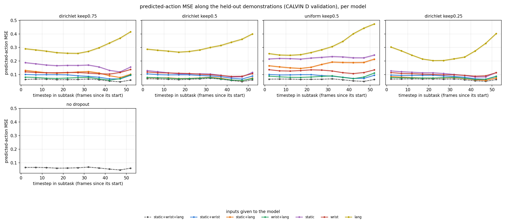
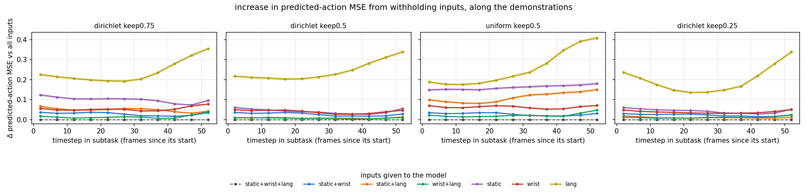
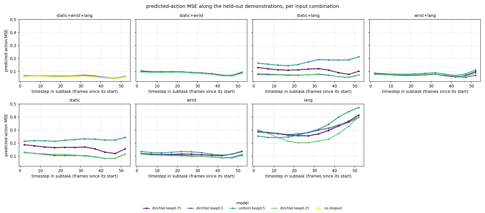
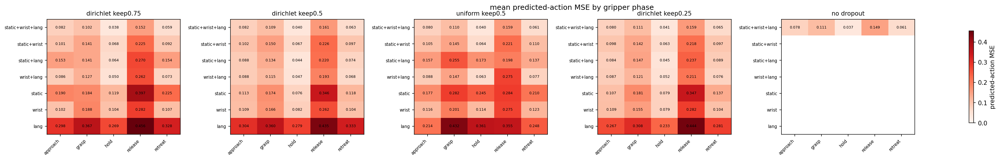

# Modality dropout for FlowerVLA: CALVIN and MimicGen results

Results of fine-tuning FlowerVLA with **modality-token dropout**, which withholds part of the camera and language tokens during training. Models are compared with ordinary fine-tuning on two simulated benchmarks:

- **CALVIN ABCD→D:** language-conditioned, long-horizon tabletop manipulation, evaluated closed loop and open loop per timestep.
- **MimicGen `core`:** 26 single-task robosuite datasets, evaluated closed loop.

Every number below comes from the evaluation files of the runs listed in [Reproduction](#reproduction). Success rates are percentages of episodes.

## Summary

- **Light dropout costs nothing with all inputs and lets the model run without some of them.**
  - On CALVIN, Dirichlet dropout that removes 25% of the tokens matches ordinary fine-tuning with every input: over 3 seeds, an average chain of 4.44 ± 0.03 vs 4.44 ± 0.05 completed subtasks.
  - Without dropout, a model cannot be given only part of its inputs at all.
- **The amount of dropout is a trade-off** (3 seeds).
  - Removing 50% of the tokens lowers the all-inputs result (4.19 ± 0.13) but gives by far the best runs without a camera: 3.76 ± 0.19 with the static camera and language, 2.58 ± 0.27 with the wrist camera and language (keep 0.75: 1.72 and 1.62).
  - Removing 75% hurts every combination, including all inputs (1.65 ± 0.09, 2 seeds).
- **Removing whole modalities in training matters, not just removing tokens.** The *uniform* variant drops a random 50% of all tokens and rarely removes a whole camera. Over three seeds it does worse with all inputs (3.63 vs 4.19 for Dirichlet) and collapses without the wrist camera (0.28 vs 3.76).
- **On CALVIN, Dirichlet keep 0.5 trained with proprioception (1 seed) does not depend on it**, and is far better without the wrist camera than without proprioception training (4.17–4.24 vs 3.76 with static camera and language). It needs more seeds to confirm.
- **Language is indispensable on CALVIN and nearly irrelevant on MimicGen.**
  - CALVIN puts several tasks in one scene, so the instruction picks the task. Without language, no CALVIN model completes more than about 0.2 subtasks per chain on average.
  - Each MimicGen scene has one task, so dropping language changes success by at most a few points.
- **Throughout a CALVIN subtask (open loop), language matters most at the start and vision matters most at the end.**
  - Removing language costs most in the first ~20 frames, when the target is chosen.
  - With language only, the prediction error grows steadily towards the end of the subtask, when positioning and release need visual feedback.
  - Release is the hardest phase for every model with all inputs.
- **Open-loop error does not predict closed-loop success with all inputs.** All five CALVIN models reach the same per-step action error on held-out demonstrations (0.061–0.065 over every seed evaluated), although their chain lengths range from 1.7 to 4.4.
- **On MimicGen, dropout with proprioception costs 5–8 points with all inputs** (45.1% for proprio keep 0.5 over 2 seeds, 48.4% for keep 1.0, vs 53.2%). Proprioception itself is neutral: without dropout it gives 53.0%.
  - Removing less (Dirichlet keep 0.75) does not close the gap (46.4%), and it gives up almost all robustness: 2–4% without either camera.
  - Both cameras matter. Without the wrist camera success falls to about 18%, without the static camera to about 10%.
  - Proprioception has to be dropped in training too: a model that always saw it falls from 48.4% to 18.0% without it.

## Setup

**Model and fine-tuning.**
- FlowerVLA, starting from the pretrained 360k-step weights, with a Florence-2 encoder over static-camera, wrist-camera and language tokens and an 18-block flow-matching action head.
- It predicts a 10-step action chunk from one observation.
- Each run: 35 epochs × 1000 optimizer updates, global batch 32, seed 42.
- Extra seeds use batch 8 × 2 accumulation instead of 4 × 4 (same global batch):
  - CALVIN no dropout, Dirichlet keep 0.75, Dirichlet keep 0.5 and uniform keep 0.5 with seeds 5 and 100; Dirichlet keep 0.25 with seed 5.
  - MimicGen Dirichlet keep 0.5 with proprio keep 0.5, seed 5; MimicGen no dropout with proprioception, seeds 42 and 5.
- New configurations, seed 42, also batch 8 × 2: CALVIN Dirichlet keep 0.5 with proprioception, MimicGen Dirichlet keep 0.75. CALVIN no dropout with proprioception was trained with seeds 42 and 5 on another host (batch split not recorded).
- Still running when this was written, so not included: MimicGen proprio keep 1.0 seed 5, MimicGen no dropout seed 5, MimicGen uniform keep 0.5, CALVIN Dirichlet keep 0.25 seed 100, and CALVIN no dropout with proprioception seed 100.
- Evaluated with the EMA weights of the last checkpoint, 4 sampling steps, and all 10 predicted actions executed.

**Modality dropout** (`model.modality_dropout=True`).
- During training each sample keeps a fraction of the camera and language tokens: the *keep fraction* (0.75 / 0.5 / 0.25, i.e. 25 / 50 / 75% removed).
- How the kept tokens are split between modalities:
  - **Dirichlet** (default): split by a per-sample draw from Dirichlet(1, 1, 1). Whole modalities are often starved or dropped.
  - **uniform:** a uniformly random subset of all tokens, so each modality keeps about the same share and a whole camera is almost never removed.
- Proprioception, where used (MimicGen), is kept with probability *proprio keep p*.
- At evaluation, a modality combination withholds whole modalities from the model.

**Evaluation.**
- **CALVIN:** the standard 1000 chains of 5 subtasks in environment D.
  - *avg_seq_len* is the mean number of subtasks completed in a row (out of 5); 5/5 is the share of chains completing all five.
  - Every combination uses the same 1000 chains and noise seeds.
- **MimicGen:** each dataset's own success criterion and rollout horizon (500–1250 steps).
  - Every run: 100 episodes per dataset and input combination (2600 per cell over the 26 datasets), 95% Wilson intervals about ±1.9 points.
  - All MimicGen evals were rerun on 2026-10-17/19 with the same code and settings. Episodes are seeded by dataset and episode index, and the rerun reproduced 99.8–100% of the earlier episode outcomes.

## CALVIN ABCD→D

### Closed loop

#### Seed 42, all models

avg_seq_len, with the share of 5/5 chains in brackets, over 1000 chains. "n/a" marks models not evaluated on that combination: the no-dropout model is only meaningful with all inputs.

| inputs | no dropout | Dirichlet keep 0.75 | Dirichlet keep 0.5 | Dirichlet keep 0.25 | uniform keep 0.5 |
|---|---|---|---|---|---|
| static+wrist+lang | 4.403 (79.4) | **4.436 (79.4)** | 4.093 (67.0) | 1.717 (9.3) | 3.551 (46.1) |
| static+wrist | n/a | 0.185 (0.0) | 0.166 (0.0) | 0.141 (0.0) | 0.172 (0.0) |
| static+lang | n/a | 1.571 (12.0) | **3.885 (57.5)** | 2.196 (17.0) | 0.292 (0.0) |
| wrist+lang | n/a | 1.498 (5.2) | **2.716 (23.1)** | 1.208 (2.1) | 1.149 (2.1) |
| static | n/a | 0.060 (0.0) | 0.196 (0.1) | 0.135 (0.0) | 0.034 (0.0) |
| wrist | n/a | 0.081 (0.0) | 0.145 (0.0) | 0.117 (0.0) | 0.084 (0.0) |
| lang | n/a | 0.000 (0.0) | 0.000 (0.0) | 0.014 (0.0) | 0.000 (0.0) |

Chain success by position with all inputs (% of chains completing at least *k* subtasks):

| model | 1/5 | 2/5 | 3/5 | 4/5 | 5/5 | avg_seq_len |
|---|---|---|---|---|---|---|
| no dropout | 96.8 | 92.2 | 88.1 | 83.8 | 79.4 | 4.40 |
| Dirichlet keep 0.75 | 97.0 | 93.6 | 89.2 | 84.4 | 79.4 | 4.44 |
| Dirichlet keep 0.5 | 96.0 | 89.5 | 82.1 | 74.7 | 67.0 | 4.09 |
| Dirichlet keep 0.25 | 70.9 | 44.8 | 28.9 | 17.8 | 9.3 | 1.72 |
| uniform keep 0.5 | 96.2 | 84.4 | 70.1 | 58.3 | 46.1 | 3.55 |

Findings:
- **Language is required.** Without it, no model gets past about 0.2 subtasks per chain on average (static+wrist 0.14–0.19), against 1.7–4.4 when language is added.
- **The static camera is worth more than the wrist camera in the Dirichlet models.** Static+lang beats wrist+lang at every keep fraction.
- **Keep 0.75 is good with all inputs but weak with any input missing**, because it rarely trained without a camera.
- **Keep 0.25 trained on so few tokens that all inputs (1.72) is worse than static+lang (2.20).** The full token count is out of distribution for it. This does not repeat with seed 5, where static+lang reaches only 1.09 (see [Several seeds](#several-seeds)).
  - Its failures with all inputs concentrate on a few subtasks: `close_drawer` 0%, `open_drawer` 3.5%, `turn_off_lightbulb` 23.5%. Seed 5 does much better on these three (about 74%, 92% and 60%), so which subtasks fail depends on the seed (the [appendix](#calvin-per-subtask-success-all-inputs) gives the means over seeds).
- **Uniform dropout fails without the wrist camera** (static+lang 0.29). It is the only model where wrist+lang beats static+lang.
  - With all inputs it is worse than Dirichlet at the same keep fraction (3.55 vs 4.09).
  - Most of that loss is one subtask: `place_in_slider` succeeds 7.4% of the time, against 76–95% for the other models.

#### Several seeds

No dropout, Dirichlet keep 0.75, Dirichlet keep 0.5 and uniform keep 0.5 were each trained with seeds 42, 5 and 100; Dirichlet keep 0.25 with seeds 42 and 5 (seed 100 is still running). Mean ± standard deviation over the seeds of avg_seq_len, and of the share of 5/5 chains (%), each seed over the same 1000 chains:

| inputs | no dropout | Dirichlet keep 0.75 | Dirichlet keep 0.5 | Dirichlet keep 0.25 (2 seeds) | uniform keep 0.5 |
|---|---|---|---|---|---|
| static+wrist+lang | **4.444 ± 0.051** (81.0 ± 2.3) | **4.442 ± 0.029** (79.3 ± 0.4) | 4.191 ± 0.131 (71.2 ± 4.9) | 1.652 ± 0.092 (8.8 ± 0.7) | 3.630 ± 0.117 (52.6 ± 5.7) |
| static+wrist | n/a | 0.174 ± 0.028 (0.0) | 0.187 ± 0.029 (0.0) | 0.156 ± 0.022 (0.0) | 0.156 ± 0.027 (0.0) |
| static+lang | n/a | 1.724 ± 0.159 (13.8 ± 2.0) | **3.759 ± 0.190** (54.6 ± 5.1) | 1.645 ± 0.779 (9.8 ± 10.3) | 0.276 ± 0.034 (0.0) |
| wrist+lang | n/a | 1.617 ± 0.126 (5.5 ± 0.7) | **2.581 ± 0.272** (21.0 ± 5.5) | 0.948 ± 0.368 (1.3 ± 1.1) | 1.072 ± 0.097 (1.5 ± 0.6) |
| static | n/a | 0.050 ± 0.010 (0.0) | 0.173 ± 0.020 (0.0) | 0.142 ± 0.010 (0.0) | 0.034 ± 0.003 (0.0) |
| wrist | n/a | 0.088 ± 0.017 (0.0) | 0.149 ± 0.009 (0.0) | 0.113 ± 0.006 (0.0) | 0.074 ± 0.028 (0.0) |
| lang | n/a | 0.000 (0.0) | 0.000 (0.0) | 0.021 ± 0.010 (0.0) | 0.000 (0.0) |

avg_seq_len of each seed with all inputs, and with one camera missing:

| model | all, seed 42 | all, seed 5 | all, seed 100 | static+lang, 42 / 5 / 100 | wrist+lang, 42 / 5 / 100 |
|---|---|---|---|---|---|
| no dropout | 4.403 | 4.501 | 4.428 | n/a | n/a |
| Dirichlet keep 0.75 | 4.436 | 4.417 | 4.474 | 1.571 / 1.713 / 1.889 | 1.498 / 1.605 / 1.749 |
| Dirichlet keep 0.5 | 4.093 | 4.340 | 4.141 | 3.885 / 3.852 / 3.540 | 2.716 / 2.268 / 2.760 |
| Dirichlet keep 0.25 | 1.717 | 1.587 | n/a | 2.196 / 1.094 / n/a | 1.208 / 0.687 / n/a |
| uniform keep 0.5 | 3.551 | 3.574 | 3.764 | 0.292 / 0.237 / 0.299 | 1.149 / 0.963 / 1.104 |

Chain success by position with all inputs, mean over the seeds (%):

| model | 1/5 | 2/5 | 3/5 | 4/5 | 5/5 | avg_seq_len |
|---|---|---|---|---|---|---|
| no dropout | 96.7 | 92.6 | 89.1 | 85.0 | 81.0 | 4.44 |
| Dirichlet keep 0.75 | 97.4 | 93.6 | 89.3 | 84.6 | 79.3 | 4.44 |
| Dirichlet keep 0.5 | 95.8 | 90.2 | 83.9 | 78.1 | 71.2 | 4.19 |
| Dirichlet keep 0.25 (2 seeds) | 69.7 | 44.0 | 26.6 | 16.1 | 8.8 | 1.65 |
| uniform keep 0.5 | 93.6 | 83.2 | 71.5 | 62.1 | 52.6 | 3.63 |

Findings:
- **Keep 0.75 and no dropout are equal with all inputs** (4.44 each). The small seed-42 lead of keep 0.75 (4.436 vs 4.403) is seed noise.
- **Keep 0.5 costs about 0.25 with all inputs, consistently.** All three of its seeds score below all six seeds of the other two models. Seed 42 was its worst seed, so the seed-42 table overstates the cost (0.31).
- **Keep 0.5's robustness without a camera is far larger than the seed spread.** Its lead over keep 0.75 is 2.0 with static+lang and 1.0 with wrist+lang, against standard deviations of 0.13–0.27.
- **Keep 0.5 varies most across seeds**, both with all inputs (± 0.13) and with wrist+lang (± 0.27). With three seeds the standard deviations are themselves rough.
- **Keep 0.25 is poor with all inputs in both seeds** (1.72 and 1.59), but its seed-42 result that static+lang beats all inputs does not repeat: seed 5 reaches only 1.09 with static+lang. Without a camera keep 0.25 is the least stable model across seeds (± 0.78 with static+lang).
- **Uniform's failure without the wrist camera is reproducible.** Static+lang is 0.29, 0.24 and 0.30 for its three seeds, against 3.76 for Dirichlet at the same keep fraction.
- **Uniform is also worse with all inputs** (3.63 vs 4.19 for Dirichlet keep 0.5), in all three seeds. Its weakest subtask is `place_in_slider`, at 7.4%, 70.9% and 42.6% success for seeds 42, 5 and 100. Every seed of no dropout and of Dirichlet keep 0.75 and 0.5 gets 76–96% there. Seed 5's much better `place_in_slider` does not raise its total (3.57 vs 3.55 for seed 42), because it loses as much elsewhere: the three `push_*_block_left` subtasks are 23–40 points lower and `rotate_pink_block_right` 46 points lower than for seed 42 (see the [appendix](#calvin-per-subtask-success-all-inputs)).

#### No dropout with proprioception

The no-dropout recipe with the robot state added as an input (`model.use_proprio=True proprio_dims=8`: gripper position, orientation, width and open/close state), seeds 42 and 5, all inputs, 1000 chains each. These two runs trained on one A100 40 GB each, 35k optimizer steps like every other run; their batch split is not recorded in W&B.

| model | seed 42 | seed 5 | mean ± sd | 5/5 (%) |
|---|---|---|---|---|
| no dropout | 4.403 | 4.501 | 4.452 ± 0.069 | 81.5 ± 3.0 |
| no dropout + proprio | 4.467 | 4.353 | 4.410 ± 0.081 | 79.9 ± 2.0 |

Chain success by position, mean over seeds 42 and 5 (%):

| model | 1/5 | 2/5 | 3/5 | 4/5 | 5/5 | avg_seq_len |
|---|---|---|---|---|---|---|
| no dropout | 96.8 | 92.6 | 89.1 | 85.3 | 81.5 | 4.45 |
| no dropout + proprio | 96.2 | 91.9 | 88.3 | 84.7 | 79.9 | 4.41 |

- **Proprioception does not measurably change CALVIN performance.** The per-seed differences go in opposite directions (+0.06 at seed 42, −0.15 at seed 5), and both are within the seed-to-seed spread of the model without it (4.40–4.50).
- These runs cannot show how much the model relies on proprioception: without dropout it is only evaluated with it. On MimicGen, withholding proprioception from a model that always saw it cost over 30 points. The dropout run below answers it for CALVIN.
- A third seed (100) is still running.

#### Dirichlet dropout with proprioception

Dirichlet keep 0.5 with the robot state as a fourth input (`model.use_proprio=True proprio_dims=8`), kept with probability 0.5 in training like on MimicGen. One seed (42), evaluated on all 14 combinations. avg_seq_len (5/5 %), against the same recipe without proprioception (3 seeds):

| inputs | with proprio | proprio withheld | trained without proprio (3 seeds) |
|---|---|---|---|
| static+wrist+lang | **4.301** (73.9) | 4.238 (73.3) | 4.191 ± 0.131 |
| static+wrist | 0.149 (0.0) | 0.178 (0.0) | 0.187 ± 0.029 |
| static+lang | 4.168 (67.0) | **4.236** (69.8) | 3.759 ± 0.190 |
| wrist+lang | 2.543 (20.4) | 2.380 (17.0) | 2.581 ± 0.272 |
| static | 0.224 (0.0) | 0.199 (0.0) | 0.173 ± 0.020 |
| wrist | 0.129 (0.0) | 0.139 (0.0) | 0.149 ± 0.009 |
| lang | 0.000 (0.0) | 0.000 (0.0) | 0.000 |

- **The model hardly relies on proprioception.** Withholding it changes avg_seq_len by at most 0.16 in any combination, and not always downwards. On MimicGen the same recipe (proprio keep 0.5) is equally indifferent to it, while proprio keep 1.0 collapses without it.
- **Without the wrist camera this run is much better than any run trained without proprioception:** 4.17–4.24 with static+lang, against 3.54–3.89 for the three seeds of keep 0.5 without it, and almost as good as with all inputs. That holds whether or not proprioception is given at evaluation, so it is not proprioception standing in for the wrist camera. With one seed this may be seed luck; it needs more seeds before it is a finding.
- With all inputs it is at the top of the keep 0.5 range (4.30 vs 4.09–4.34), still below no dropout (4.44).

### Open loop along the demonstrations

**Method.**
- **Data:** the CALVIN `validation/` split, environment D demonstrations that no run trains on.
  - It has 1,087 language-annotated subtask windows of 34–65 frames (77% are 65 frames), covering 34 subtask types.
  - Every observation frame whose 10-step action chunk stays inside its window is one sample: 53,923 in total.
- **Losses:** for each model and input combination, two per-sample losses against the demonstrated actions:
  - **predicted-action MSE:** the error of the action chunk the policy samples, as in a rollout;
  - **training loss:** the flow-matching objective at five fixed noise levels.
- **Determinism:** noise is seeded per frame, so every model and combination sees the same draws.
- **Batching:** batches never mix subtask windows. Language is padded to the batch's longest instruction, and the action head attends to the padded positions, so in early test runs that mixed instructions the padding changed the loss by up to 0.18.
  - Within one window every sample has the same instruction, so no padding occurs, the same as in a rollout. Combinations without language have no text tokens at all.
  - Check: 202 samples (one per task × 10-frame bin) were re-scored per model and combination with batch size 1. No pad tokens appeared. The re-scored losses match the reported ones to within 5e-5, far below the 0.01–0.04 effects reported.

**Annotations per sample.** Each sample records:
- its subtask;
- its timestep: frames since the start of the annotated window;
- a heuristic gripper phase from the gripper command over the window:
  - *approach*: before the first close;
  - *grasp*: within ±2 frames of closing;
  - *hold*: closed;
  - *release*: within ±2 frames of opening;
  - *retreat*: after reopening.

The gripper closes at least once in every window, so pushes and button presses also get approach/hold labels.

Mean predicted-action MSE over all samples (lower is better):

| inputs | no dropout | Dirichlet keep 0.75 | Dirichlet keep 0.5 | Dirichlet keep 0.25 | uniform keep 0.5 |
|---|---|---|---|---|---|
| static+wrist+lang | 0.062 | 0.063 | 0.065 | 0.065 | 0.064 |
| static+wrist | n/a | 0.091 | 0.092 | 0.088 | 0.092 |
| static+lang | n/a | 0.112 | 0.073 | 0.075 | 0.173 |
| wrist+lang | n/a | 0.076 | 0.072 | 0.076 | 0.085 |
| static | n/a | 0.163 | 0.107 | 0.109 | 0.224 |
| wrist | n/a | 0.116 | 0.105 | 0.103 | 0.127 |
| lang | n/a | 0.296 | 0.302 | 0.260 | 0.310 |

**With missing inputs, the ordering of the models follows the closed-loop results:**
- uniform is worst without the wrist camera;
- keep 0.75 is worse than keep 0.5 without the wrist camera.

**With all inputs, every model scores the same (0.062–0.065), unlike in closed loop.** Predicting the next actions from a demonstration's states is not where the models differ. The difference shows up once a model's own actions take it off the demonstrated states.

**Other seeds.** The open-loop evaluation was repeated for the seed-5 and seed-100 runs of no dropout and Dirichlet keep 0.75 and 0.5, and for uniform seed 100 (the uniform seed-5 and keep 0.25 seed-5 runs are not scored yet). Mean predicted-action MSE, mean ± sd over the seeds:

| inputs | no dropout (3) | Dirichlet keep 0.75 (3) | Dirichlet keep 0.5 (3) | Dirichlet keep 0.25 (1) | uniform keep 0.5 (2) |
|---|---|---|---|---|---|
| static+wrist+lang | 0.062 ± 0.001 | 0.063 ± 0.000 | 0.065 ± 0.001 | 0.065 | 0.064 ± 0.001 |
| static+wrist | n/a | 0.089 ± 0.002 | 0.091 ± 0.001 | 0.088 | 0.090 ± 0.002 |
| static+lang | n/a | 0.114 ± 0.002 | 0.072 ± 0.002 | 0.075 | 0.156 ± 0.024 |
| wrist+lang | n/a | 0.077 ± 0.001 | 0.075 ± 0.003 | 0.076 | 0.085 ± 0.000 |
| static | n/a | 0.166 ± 0.003 | 0.106 ± 0.002 | 0.109 | 0.206 ± 0.025 |
| wrist | n/a | 0.118 ± 0.002 | 0.110 ± 0.004 | 0.103 | 0.125 ± 0.003 |
| lang | n/a | 0.298 ± 0.006 | 0.300 ± 0.003 | 0.260 | 0.291 ± 0.026 |

- **The open-loop results do not depend on the seed.** With all inputs every seed of every model is within 0.061–0.065, and the seed spread is at most 0.004 for no dropout and the two Dirichlet models.
- **Uniform varies more across seeds when the wrist camera is missing** (± 0.024–0.025 with static+lang and static only), but in both seeds it is still the worst model in those combinations.

Predicted-action MSE along the subtask, one panel per model:



The same, as the increase over each model's own all-inputs error. All inputs is the dashed zero line.



One panel per input combination, models overlaid (the no-dropout model only has all inputs):



**Cost of each modality over time.** The tables give the increase in predicted-action MSE over all inputs from removing one modality, or from keeping language only, in 10-frame bins. The all-inputs error itself is about 0.06–0.07.

Dirichlet keep 0.5:

| frames | no static | no wrist | no lang | lang only |
|---|---|---|---|---|
| 0–9 | 0.009 | 0.008 | 0.034 | 0.214 |
| 10–19 | 0.008 | 0.010 | 0.034 | 0.205 |
| 20–29 | 0.006 | 0.007 | 0.029 | 0.209 |
| 30–39 | 0.004 | 0.007 | 0.017 | 0.237 |
| 40–49 | 0.006 | 0.005 | 0.018 | 0.297 |
| 50–59 | 0.010 | 0.013 | 0.028 | 0.338 |

Uniform keep 0.5:

| frames | no static | no wrist | no lang | lang only |
|---|---|---|---|---|
| 0–9 | 0.019 | 0.094 | 0.032 | 0.182 |
| 10–19 | 0.014 | 0.082 | 0.033 | 0.178 |
| 20–29 | 0.019 | 0.098 | 0.030 | 0.206 |
| 30–39 | 0.020 | 0.125 | 0.019 | 0.258 |
| 40–49 | 0.024 | 0.137 | 0.020 | 0.369 |
| 50–59 | 0.048 | 0.150 | 0.031 | 0.409 |

Dirichlet keep 0.75 and 0.25 follow keep 0.5's pattern. One difference: keep 0.75 also loses 0.04–0.06 throughout without the wrist camera.

**How each modality matters through a subtask:**
1. **Language matters most early, while the target is chosen.** Removing it costs about 0.03 in the first 20 frames and about half that in frames 30–49, then rises slightly at the very end.
2. **Vision matters more as the subtask proceeds.** With language only, the gap grows from about 0.2 in the first frames to 0.34–0.41 in the last.
3. **Whether the two cameras can stand in for each other depends on training.**
   - In Dirichlet keep 0.5 and 0.25, removing either camera costs ≤ 0.01 for most of the subtask; both matter a little more in the last ~10 frames.
   - The uniform model never learned to do without the wrist camera. Its cost grows from 0.08 to 0.15 over the subtask, i.e. it leans on the wrist view most near contact.

Predicted-action MSE by gripper phase, one heatmap per model:



**With all inputs, release is the hardest phase for every model**, even though it is only 2.8% of the samples. It is also the hardest for most reduced combinations; the exception is the uniform model without the wrist camera, which does worst while grasping and holding. All-inputs MSE by phase is 0.15–0.16 at release vs 0.04 during hold. Approach is 34% of the samples, grasp 8%, hold 48% and retreat 7%.

**Caveats.**
- CALVIN's annotated windows are cut around the moment a subtask is completed, so frame 0 is an approximate start.
- Only the 65-frame windows reach the last timesteps; bins with fewer than 200 samples are not drawn.
- The 95% intervals in the figures treat overlapping frames of one window as independent, so they are too narrow.

## MimicGen

All 26 MimicGen `core` datasets (12 task families, difficulty variants d0–d2), 100 demonstrations each, are trained jointly with the CALVIN fine-tuning recipe. Unlike CALVIN, each scene contains a single task.

### Modality combinations

Success rate (%) per input combination, on 100 episodes per dataset × 26 datasets = 2600 per cell and seed (95% Wilson interval about ±1.9 points for one seed, ±1.4 for two pooled seeds).
- The dropout runs use proprioception and are evaluated on every combination: Dirichlet keep 0.5 with proprio keep 0.5 (seeds 42 and 5, pooled) and with proprio keep 1.0 (seed 42), and Dirichlet keep 0.75 with proprio keep 0.5 (seed 42).
- The no-dropout runs are evaluated with all inputs only: without proprioception (seed 42), and with it (seeds 42 and 5, pooled: 53.1% and 52.9%).

| inputs | no dropout | no dropout + proprio (2 seeds) | keep 0.5, proprio keep 0.5 (2 seeds) | keep 0.5, proprio keep 1.0 | keep 0.75, proprio keep 0.5 |
|---|---|---|---|---|---|
| static+wrist+lang+proprio | n/a | 53.0 | 45.1 | 48.4 | 46.4 |
| static+wrist+lang | **53.2** | n/a | 44.4 | 18.0 | 45.5 |
| static+wrist+proprio | n/a | n/a | 45.6 | 46.5 | 47.3 |
| static+wrist | n/a | n/a | 45.2 | 18.0 | 45.3 |
| static+lang+proprio | n/a | n/a | 17.5 | 17.7 | 3.7 |
| static+lang | n/a | n/a | 17.8 | 6.6 | 4.0 |
| wrist+lang+proprio | n/a | n/a | 9.9 | 18.3 | 2.2 |
| wrist+lang | n/a | n/a | 6.4 | 2.0 | 1.7 |
| static+proprio | n/a | n/a | 17.3 | 17.4 | 2.6 |
| static | n/a | n/a | 17.7 | 6.5 | 2.6 |
| wrist+proprio | n/a | n/a | 8.9 | 15.3 | 4.3 |
| wrist | n/a | n/a | 5.2 | 2.0 | 2.7 |
| lang+proprio | n/a | n/a | 0.0 | 0.0 | 0.0 |
| lang | n/a | n/a | 0.0 | 0.0 | 0.0 |

The two seeds of keep 0.5 with proprio keep 0.5 differ by up to 5 points in a cell: 46.6% vs 43.5% with all inputs, 20.1% vs 14.9% with static+lang+proprio, and within 1.5 points for every combination without the static camera.

Findings:
- **Language barely matters.** Without it, success is 45.6% (proprio keep 0.5), 46.5% (keep 1.0) and 47.3% (keep 0.75), against 45.1%, 48.4% and 46.4% with it. The scene already determines the task.
- **Both cameras are needed, and they complement each other.**
  - Removing the wrist camera drops success from 45.1% to 17.5%; removing the static camera drops it to 9.9% (proprio keep 0.5).
  - Either camera alone gives 5–18% (proprio keep 0.5).
  - This differs from CALVIN, where the Dirichlet keep 0.5 models lose little from one missing camera. MimicGen's precise insertion and assembly tasks need both views at once.
- **Removing less does not close the gap to no dropout, and gives up robustness.** Keep 0.75 reaches 46.4% with all inputs, the same as keep 0.5 (45.1%), but only 2–4% with either camera missing, against 5–18% for keep 0.5. On CALVIN keep 0.75 also lost most of its robustness without a camera, but not as completely.
- **Proprioception has to be dropped in training too.**
  - With keep 1.0 (proprioception always present in training), removing it collapses success: 48.4% → 18.0% with every other input.
  - With keep 0.5 the model is indifferent to it (45.1% vs 44.4%).
  - With all inputs keep 1.0 is 3 points above keep 0.5 (48.4% vs 45.1%), about the distance between the two keep 0.5 seeds, so with one keep 1.0 seed the two cannot be told apart.
- **Proprioception alone does not help.** Without dropout, adding it gives 53.0% against 53.2% without.
- **Dropout with all inputs is 5–8 points below no dropout** (45.1% / 48.4% / 46.4% vs 53.2%). The gap is largest on `threading_d0` (17–28% vs 62%), `pick_place_d0` (24–36% vs 47%, except keep 0.75 at 46%) and `coffee_preparation_d1` (11–18% vs 35%; see the [appendix](#mimicgen-per-dataset-success-all-inputs)).
  - On `threading_d0` the no-dropout runs with proprioception are low too (37% / 42%), so that gap comes partly from proprioception, not from dropout.

### Task family × difficulty, all inputs (%)

Each model is evaluated with all of its inputs; "+ proprio" is no dropout with proprioception and "proprio keep 0.5" is Dirichlet keep 0.5 with proprio keep 0.5, each pooled over seeds 42 and 5. Keep 0.75 is in the [appendix](#mimicgen-per-dataset-success-all-inputs).

| family | no dropout d0 | d1 | d2 | + proprio d0 | d1 | d2 | proprio keep 0.5 d0 | d1 | d2 | proprio keep 1.0 d0 | d1 | d2 |
|---|---|---|---|---|---|---|---|---|---|---|---|---|
| coffee | 95 | 65 | 14 | 86 | 74 | 27 | 90 | 48 | 10 | 88 | 73 | 14 |
| coffee_preparation | 61 | 35 | – | 81 | 34 | – | 58 | 13 | – | 64 | 18 | – |
| hammer_cleanup | 98 | 65 | – | 98 | 58 | – | 90 | 45 | – | 94 | 53 | – |
| kitchen | 100 | 68 | – | 100 | 62 | – | 100 | 64 | – | 100 | 51 | – |
| mug_cleanup | 67 | 46 | – | 62 | 46 | – | 49 | 31 | – | 56 | 36 | – |
| nut_assembly | 15 | – | – | 21 | – | – | 12 | – | – | 11 | – | – |
| pick_place | 47 | – | – | 44 | – | – | 36 | – | – | 24 | – | – |
| square | 71 | 38 | 31 | 79 | 40 | 22 | 62 | 34 | 22 | 67 | 47 | 36 |
| stack | 99 | 99 | – | 100 | 99 | – | 98 | 100 | – | 100 | 100 | – |
| stack_three | 82 | 71 | – | 86 | 70 | – | 84 | 69 | – | 81 | 74 | – |
| threading | 62 | 10 | 3 | 40 | 4 | 4 | 22 | 4 | 2 | 23 | 6 | 2 |
| three_piece_assembly | 21 | 15 | 5 | 22 | 18 | 2 | 14 | 12 | 2 | 21 | 15 | 4 |

Success falls steeply with difficulty everywhere. The d2 variants, which randomize object poses widely, stay at 2–36% for every model.

### Ablations (no dropout, all inputs)

| run | change from the reference | SR % | episodes |
|---|---|---|---|
| 2026-10-01_19-26-58 | reference: 26 datasets, 35 epochs | 53.2 | 2600 |
| 2026-10-01_19-26-58 | execute 5 of the 10 predicted actions before replanning | 51.1 | 2600 |
| 2026-10-01_19-26-58 | 20 sampling steps instead of 4 | 47.6 | 2600 |
| 2026-10-01_19-26-58 | three-piece assembly, rollout horizon ×1.25 | 15.7 | 300 |
| 2026-10-02_14-43-02 | trained on 6 datasets only, evaluated on all 26 | 15.3 | 2600 |
| 2026-10-02_14-43-02 | the same, three-piece assembly, horizon ×1.25 | 7.0 | 300 |
| 2026-10-04_13-09-51_6ds_2x | 6 datasets, 70 epochs, evaluated on those 6 | 35.5 | 600 |
| 2026-10-04_13-09-54_6ds_2x_dit12 | 6 datasets, 70 epochs, 12-block action head | 37.0 | 600 |

The 6 datasets are: `coffee_preparation_d1`, `pick_place_d0`, `square_d2`, `stack_three_d1`, `threading_d2`, `three_piece_assembly_d2`.

An earlier 40-epoch run (`2026-09-30_17-05-35`, 52.0%) is left out: it was trained on an older rendering of the datasets (224 px cameras, 112 px model input), so it is not comparable with these runs.

- **Replanning more often or sampling more carefully does not help:**
  - executing only 5 of the 10 predicted actions gives 51.1%;
  - 20 sampling steps gives 47.6%, worse than the default 4.
- **Three-piece assembly is not limited by its time budget.** With 25% more steps it reaches 15.7% vs 13.7% for the reference on the same three datasets.
- **Specializing on the 6 hardest datasets gains little.**
  - The 26-dataset model scores 32.0% on those 6.
  - A 6-dataset model scores 35.3% at 35 epochs, 35.5% at 70 epochs, and 37.0% with a 12-block action head.
  - It scores 9.3% on the 20 datasets it never saw, so there is little transfer between task families.

## Across the two benchmarks

- **Language matters only when the scene is ambiguous.** CALVIN needs it to know which of several tasks to do; MimicGen does not.
- **The static camera is the stronger single view on both benchmarks.** How well the wrist camera substitutes for it depends on the task: well on CALVIN's coarse tabletop tasks, poorly on MimicGen's precise assembly and insertion tasks.
- **How dropout is applied matters as much as how much is applied.**
  - Dropout makes a model work without some inputs only if training removed *whole* modalities often enough: Dirichlet rather than uniform, and proprioception keep below 1.
  - Heavy dropout (keep 0.25) moves the training inputs so far from the full input that the full input itself becomes out of distribution.

## Reproduction

Training runs live under `$SAVES_DIR/train_logs/`, and closed-loop results in `<run>/eval_logs/last/<suite>/result.csv`.

| model | run |
|---|---|
| CALVIN no dropout | `calvin_abcd_d/2026-10-07_17-51-44` |
| CALVIN Dirichlet keep 0.75 | `calvin_abcd_d_dropout/2026-10-08_20-42-04` |
| CALVIN Dirichlet keep 0.5 | `calvin_abcd_d_dropout/2026-10-07_17-31-38` |
| CALVIN Dirichlet keep 0.25 | `calvin_abcd_d_dropout/2026-10-08_20-42-09` |
| CALVIN uniform keep 0.5 | `calvin_abcd_d_dropout/2026-10-10_10-59-33` |
| CALVIN no dropout, seeds 5 / 100 | `calvin_abcd_d/2026-10-12_22-31-31` / `2026-10-12_22-32-26` |
| CALVIN Dirichlet keep 0.75, seeds 5 / 100 | `calvin_abcd_d_dropout/2026-10-13_11-14-02` / `2026-10-13_11-14-03` |
| CALVIN Dirichlet keep 0.5, seeds 5 / 100 | `calvin_abcd_d_dropout/2026-10-12_22-47-23` / `2026-10-12_22-47-28` |
| CALVIN uniform keep 0.5, seeds 5 / 100 | `calvin_abcd_d_dropout/2026-10-21_03-14-30` / `2026-10-14_09-58-42` |
| CALVIN Dirichlet keep 0.25, seed 5 | `calvin_abcd_d_dropout/2026-10-23_16-48-27` |
| CALVIN Dirichlet keep 0.5 + proprio | `calvin_abcd_d_dropout/2026-10-21_03-14-19` |
| CALVIN no dropout + proprio, seeds 42 / 5 | `calvin_abcd_d/2026-10-14_13-37-34` / `2026-10-14_13-37-42` (W&B runs `calvin_abcd_d_2026-10-14_13-37-34` / `_13-37-42`; trained on another host) |
| MimicGen no dropout | `mimicgen/2026-10-01_19-26-58` |
| MimicGen no dropout + proprio, seeds 42 / 5 | `mimicgen/2026-10-16_16-38-11` / `2026-10-16_16-38-21` |
| MimicGen dropout, proprio keep 0.5 / 1.0 | `mimicgen_dropout/2026-10-05_09-31-11_pkeep0.5` / `_pkeep1.0` |
| MimicGen dropout, proprio keep 0.5, seed 5 | `mimicgen_dropout/2026-10-19_11-46-58` |
| MimicGen Dirichlet keep 0.75, proprio keep 0.5 | `mimicgen_dropout/2026-10-19_11-47-04` |

```bash
# CALVIN: train (auto-runs the closed-loop pipeline afterwards), open loop, figures
CUDA_VISIBLE_DEVICES=0,1 ./run.sh train-calvin batch_size=4 accumulate_grad_batches=4
CUDA_VISIBLE_DEVICES=2,3 ./run.sh train-calvin-dropout batch_size=4 accumulate_grad_batches=4 \
    model.modality_dropout_keep_fraction=0.75          # or 0.5, 0.25
./run.sh train-calvin-dropout batch_size=4 accumulate_grad_batches=2 model.modality_dropout_strategy=uniform
# extra seeds (5, 100)
CUDA_VISIBLE_DEVICES=0,1 ./run.sh train-calvin-dropout batch_size=8 accumulate_grad_batches=2 seed=5 \
    model.modality_dropout_keep_fraction=0.75          # or train-calvin / keep 0.5
# no dropout with proprioception (CALVIN's robot state has 8 dims after keep_indices)
./run.sh train-calvin model.use_proprio=True proprio_dims=8 seed=42
# Dirichlet dropout with proprioception
./run.sh train-calvin-dropout batch_size=8 accumulate_grad_batches=2 model.use_proprio=True proprio_dims=8
CUDA_VISIBLE_DEVICES=0 ./run.sh open-loop-calvin /saves/train_logs/calvin_abcd_d_dropout/<ts>
./run.sh analyze-open-loop

# MimicGen
./run.sh train-mimicgen
./run.sh train-mimicgen batch_size=8 accumulate_grad_batches=2 model.use_proprio=True seed=5
# re-evaluate an existing run at 100 episodes per dataset (and combination)
PIPELINE_REEVAL=1 ./run.sh pipeline-mimicgen /saves/train_logs/mimicgen/<run> n_eval=100
./run.sh train-mimicgen-dropout model.use_proprio=True model.modality_dropout_proprio_keep_p=0.5
# Dirichlet keep 0.75; SKIP_PIPELINE=1 then pipeline-mimicgen n_eval=100, since the chained eval runs 20 episodes
SKIP_PIPELINE=1 ./run.sh train-mimicgen-dropout batch_size=8 accumulate_grad_batches=2 model.use_proprio=True \
    model.modality_dropout_keep_fraction=0.75
```

## Appendix

### CALVIN per-subtask success, all inputs

Success rate (%) of each attempted subtask in the 1000 closed-loop chains, averaged over the seeds of each model (number of seeds in brackets).

| subtask | no dropout (3 seeds) | Dirichlet keep 0.75 (3) | Dirichlet keep 0.5 (3) | Dirichlet keep 0.25 (2) | uniform keep 0.5 (3) |
|---|---|---|---|---|---|
| close_drawer | 100.0 | 100.0 | 100.0 | 36.8 | 100.0 |
| lift_blue_block_drawer | 98.4 | 96.4 | 96.6 | 72.7 | 97.9 |
| lift_blue_block_slider | 94.5 | 93.3 | 91.0 | 77.0 | 92.9 |
| lift_blue_block_table | 99.8 | 99.5 | 99.4 | 69.5 | 99.2 |
| lift_pink_block_drawer | 94.9 | 95.2 | 91.0 | 62.5 | 88.6 |
| lift_pink_block_slider | 97.9 | 97.9 | 96.6 | 82.0 | 98.2 |
| lift_pink_block_table | 98.9 | 97.2 | 97.9 | 35.7 | 92.9 |
| lift_red_block_drawer | 94.1 | 98.1 | 98.1 | 75.0 | 93.9 |
| lift_red_block_slider | 96.1 | 96.3 | 96.1 | 77.0 | 95.3 |
| lift_red_block_table | 99.3 | 98.8 | 98.5 | 51.5 | 98.6 |
| move_slider_left | 100.0 | 99.6 | 99.2 | 99.3 | 99.4 |
| move_slider_right | 100.0 | 99.8 | 100.0 | 99.7 | 99.7 |
| open_drawer | 99.9 | 99.6 | 99.9 | 47.8 | 99.6 |
| place_in_drawer | 99.8 | 98.6 | 98.7 | 89.8 | 99.2 |
| place_in_slider | 95.4 | 91.7 | 83.4 | 26.3 | 40.3 |
| push_blue_block_left | 92.8 | 93.3 | 86.1 | 53.5 | 76.2 |
| push_blue_block_right | 72.2 | 74.8 | 60.6 | 24.3 | 37.3 |
| push_into_drawer | 81.3 | 79.0 | 79.6 | 79.1 | 81.0 |
| push_pink_block_left | 88.7 | 91.7 | 84.7 | 48.2 | 74.0 |
| push_pink_block_right | 71.6 | 81.5 | 73.6 | 38.6 | 65.9 |
| push_red_block_left | 90.7 | 94.8 | 91.3 | 53.3 | 80.5 |
| push_red_block_right | 68.8 | 71.2 | 59.4 | 23.0 | 47.6 |
| rotate_blue_block_left | 100.0 | 99.0 | 97.5 | 89.6 | 99.5 |
| rotate_blue_block_right | 94.9 | 93.1 | 92.2 | 80.7 | 94.4 |
| rotate_pink_block_left | 95.9 | 98.2 | 93.9 | 71.8 | 93.0 |
| rotate_pink_block_right | 76.9 | 84.3 | 95.3 | 53.4 | 79.2 |
| rotate_red_block_left | 99.5 | 99.5 | 100.0 | 77.1 | 98.9 |
| rotate_red_block_right | 95.1 | 94.6 | 95.0 | 71.1 | 97.6 |
| stack_block | 93.2 | 88.8 | 84.0 | 65.5 | 85.1 |
| turn_off_led | 99.2 | 98.8 | 99.6 | 99.1 | 99.1 |
| turn_off_lightbulb | 100.0 | 99.6 | 90.4 | 41.6 | 98.1 |
| turn_on_led | 98.4 | 98.7 | 99.0 | 100.0 | 99.1 |
| turn_on_lightbulb | 99.8 | 100.0 | 99.8 | 71.9 | 100.0 |
| unstack_block | 99.5 | 99.0 | 99.5 | 97.9 | 99.5 |

### MimicGen per-dataset success, all inputs

Success rate (%), 100 episodes per dataset. The dropout runs and the "+ proprio" runs are evaluated with all four inputs.

| dataset | no dropout | + proprio, seed 42 | + proprio, seed 5 | keep 0.5, proprio keep 0.5, seed 42 | same, seed 5 | keep 0.5, proprio keep 1.0 | keep 0.75, proprio keep 0.5 |
|---|---|---|---|---|---|---|---|
| coffee_d0 | 95 | 93 | 78 | 88 | 93 | 88 | 74 |
| coffee_d1 | 65 | 77 | 71 | 50 | 46 | 73 | 52 |
| coffee_d2 | 14 | 21 | 33 | 10 | 9 | 14 | 10 |
| coffee_preparation_d0 | 61 | 71 | 91 | 39 | 78 | 64 | 66 |
| coffee_preparation_d1 | 35 | 31 | 38 | 14 | 12 | 18 | 11 |
| hammer_cleanup_d0 | 98 | 95 | 100 | 89 | 91 | 94 | 98 |
| hammer_cleanup_d1 | 65 | 64 | 52 | 48 | 42 | 53 | 51 |
| kitchen_d0 | 100 | 100 | 100 | 100 | 100 | 100 | 99 |
| kitchen_d1 | 68 | 65 | 58 | 68 | 61 | 51 | 62 |
| mug_cleanup_d0 | 67 | 66 | 58 | 50 | 48 | 56 | 53 |
| mug_cleanup_d1 | 46 | 48 | 45 | 39 | 23 | 36 | 50 |
| nut_assembly_d0 | 15 | 24 | 18 | 17 | 7 | 11 | 6 |
| pick_place_d0 | 47 | 42 | 45 | 35 | 36 | 24 | 46 |
| square_d0 | 71 | 87 | 71 | 69 | 54 | 67 | 69 |
| square_d1 | 38 | 35 | 45 | 41 | 28 | 47 | 31 |
| square_d2 | 31 | 19 | 25 | 26 | 18 | 36 | 22 |
| stack_d0 | 99 | 100 | 99 | 99 | 98 | 100 | 98 |
| stack_d1 | 99 | 99 | 99 | 100 | 99 | 100 | 100 |
| stack_three_d0 | 82 | 87 | 84 | 89 | 78 | 81 | 82 |
| stack_three_d1 | 71 | 74 | 65 | 73 | 65 | 74 | 70 |
| threading_d0 | 62 | 37 | 42 | 28 | 17 | 23 | 26 |
| threading_d1 | 10 | 5 | 4 | 6 | 2 | 6 | 4 |
| threading_d2 | 3 | 3 | 5 | 3 | 1 | 2 | 1 |
| three_piece_assembly_d0 | 21 | 21 | 24 | 18 | 11 | 21 | 13 |
| three_piece_assembly_d1 | 15 | 14 | 23 | 10 | 13 | 15 | 9 |
| three_piece_assembly_d2 | 5 | 2 | 2 | 2 | 2 | 4 | 4 |
