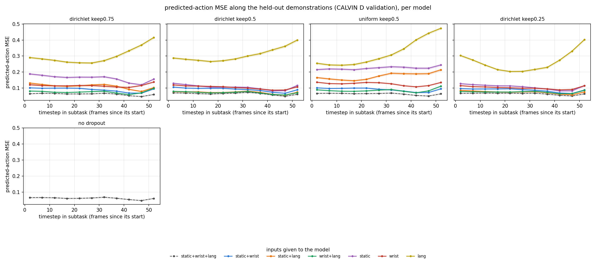
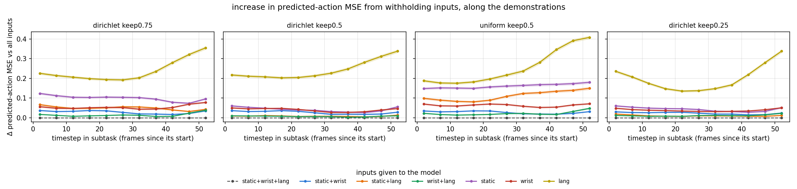
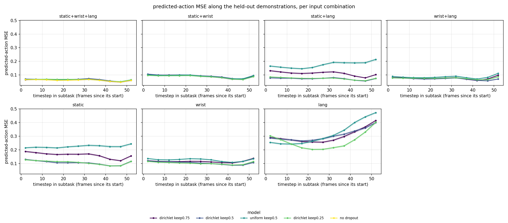
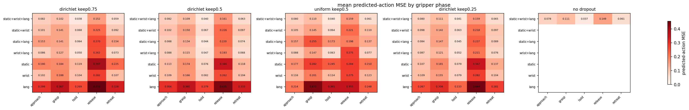

# Modality dropout for FlowerVLA: CALVIN, MimicGen and LIBERO results

Results of fine-tuning FlowerVLA with **modality-token dropout**, which withholds part of the camera and language tokens during training. Models are compared with ordinary fine-tuning on three simulated benchmarks:

- **CALVIN ABCD→D:** language-conditioned, long-horizon tabletop manipulation, evaluated closed loop and open loop per timestep.
- **MimicGen `core`:** 26 single-task robosuite datasets, evaluated closed loop.
- **LIBERO-10:** ten long-horizon tabletop tasks. It is evaluated closed loop on the original tasks, on 2519 perturbed versions of them (LIBERO-Plus), and on modified tasks (LIBERO-PRO).

Every number below comes from the evaluation files of the runs listed in [Reproduction](#reproduction) and, for LIBERO, in the [LIBERO section](#libero). Success rates are percentages of episodes.

## Summary

- **On CALVIN, light dropout costs nothing with all inputs and lets the model run without some of them.**
  - On CALVIN, Dirichlet dropout that removes 25% of the tokens matches ordinary fine-tuning with every input: over 3 seeds, an average chain of 4.44 ± 0.03 vs 4.44 ± 0.05 completed subtasks.
  - Without dropout, a model cannot be given only part of its inputs at all.
  - On MimicGen even light dropout (keep 0.75) costs about 4 points with all inputs.
- **The amount of dropout is a trade-off** (3 seeds).
  - Removing 50% of the tokens lowers the all-inputs result (4.19 ± 0.13) but gives by far the best runs without a camera: 3.76 ± 0.19 with the static camera and language, 2.58 ± 0.27 with the wrist camera and language (keep 0.75: 1.72 and 1.62).
  - Removing 75% hurts every combination, including all inputs (1.64 ± 0.07).
- **Removing whole modalities in training matters, not just removing tokens.** The *uniform* variant drops a random 50% of all tokens and rarely removes a whole camera. Over three seeds it does worse with all inputs (3.63 vs 4.19 for Dirichlet) and collapses without the wrist camera (0.28 vs 3.76). On MimicGen (2 seeds) it matches Dirichlet with all inputs but gets 0–4% with either camera missing.
- **On CALVIN, Dirichlet keep 0.5 trained with proprioception (3 seeds) does not depend on it.** With all inputs it is the most consistent dropout model (4.31 ± 0.03), and without the wrist camera it is somewhat better than without proprioception training (3.94 vs 3.76 with static camera and language), within the seed spread.
  - With proprioception always kept in training (proprio keep 1.0, 2 seeds), the CALVIN model depends on it as on MimicGen and LIBERO: withholding it halves avg_seq_len (e.g. 4.10 → 1.97 with all inputs).
- **Language is indispensable on CALVIN and nearly irrelevant on MimicGen.**
  - CALVIN puts several tasks in one scene, so the instruction picks the task. Without language, no CALVIN model completes more than about 0.2 subtasks per chain on average.
  - Each MimicGen scene has one task, so dropping language changes success by at most a few points. The one exception, uniform seed 42 (46.9% → 34.7%), was not reproduced by seed 5.
- **Throughout a CALVIN subtask (open loop), language matters most at the start and vision matters most at the end.**
  - Removing language costs most in the first ~20 frames, when the target is chosen.
  - With language only, the prediction error grows steadily towards the end of the subtask, when positioning and release need visual feedback.
  - Release is the hardest phase for every model with all inputs.
- **Open-loop error does not predict closed-loop success with all inputs.** All five CALVIN models reach the same per-step action error on held-out demonstrations (0.061–0.067 over all three seeds), although their chain lengths range from 1.7 to 4.4.
- **On MimicGen, dropout with proprioception costs 4–6 points with all inputs** (45.1% and 47.0% for proprio keep 0.5 and 1.0, vs 50.8% without dropout; 2 seeds each). Seeds of the same model differ by up to about 6 points, so smaller MimicGen differences between single runs are noise. Proprioception without dropout does not clearly help (53.0% vs 50.8%).
  - Removing less (Dirichlet keep 0.75) does not close the gap (46.4%), and it gives up almost all robustness: 2–4% without either camera.
  - Both cameras matter. Without the wrist camera success falls to about 18%, without the static camera to about 10%.
  - Proprioception has to be dropped in training too: a model that always saw it falls from 47.0% to 15.2% without it (2 seeds).
- **On LIBERO-10, dropout costs nothing on the original tasks and makes the model more robust to perturbations** (3 seeds per model).
  - With all inputs every model scores 91.5–95.3% on LIBERO-10.
  - On the 2519 perturbed LIBERO-Plus tasks the dropout models average 74.5–79.6%, against 68.3–72.2% without dropout. Two dropout seeds (70.7% and 73.7%) fall inside the no-dropout range (64.6–75.4%).
  - The gain grows with the size of the perturbation, e.g. 11–19 points at the largest robot initial-pose offset.
  - The largest gains are for camera viewpoints and the robot initial pose, then reworded instructions.
  - Proprio keep 1.0 is the most robust (79.6%) but, as on MimicGen, collapses without proprioception.
  - Without dropout, withholding language or the wrist camera gives 0%. The dropout models keep 62–73% on LIBERO-Plus without language or the static camera.
  - Whole-modality dropout (`subset`, 2 seeds) is the most robust: 85.2% on LIBERO-Plus with all inputs, and the best model with any single input withheld (e.g. 35% vs 19–23% without the wrist camera).
  - No model survives a changed task on LIBERO-PRO (0–12%).
  - Excluded runs and evaluations are listed under [missing or unusable results](#missing-or-unusable-libero-results).

## Setup

**Model and fine-tuning.**
- FlowerVLA, starting from the pretrained 360k-step weights, with a Florence-2 encoder over static-camera, wrist-camera and language tokens and an 18-block flow-matching action head.
- It predicts a 10-step action chunk from one observation.
- Each run: 35 epochs × 1000 optimizer updates, global batch 32, seed 42.
- Extra seeds use batch 8 × 2 accumulation instead of 4 × 4 (same global batch):
  - CALVIN: every model with seeds 5 and 100.
  - MimicGen: no dropout and Dirichlet keep 0.5 with proprio keep 0.5 and 1.0, seed 5; no dropout with proprioception, seeds 42 and 5.
- New configurations, seed 42, also batch 8 × 2: CALVIN Dirichlet keep 0.5 with proprioception; MimicGen Dirichlet keep 0.75 and uniform keep 0.5, both with proprio keep 0.5.
- CALVIN no dropout with proprioception: seeds 42 and 5 trained on another host (batch split not recorded), seed 100 with batch 8 × 2.
- Evaluated with the EMA weights of the last checkpoint, 4 sampling steps, and all 10 predicted actions executed.

**Modality dropout** (`model.modality_dropout=True`).
- During training each sample keeps a fraction of the camera and language tokens: the *keep fraction* (0.75 / 0.5 / 0.25, i.e. 25 / 50 / 75% removed).
- How the kept tokens are split between modalities:
  - **Dirichlet** (default): split by a per-sample draw from Dirichlet(1, 1, 1). Whole modalities are often starved or dropped.
  - **uniform:** a uniformly random subset of all tokens, so each modality keeps about the same share and a whole camera is almost never removed.
- Proprioception, where used (MimicGen), is kept with probability *proprio keep p*.
- At evaluation, a modality combination withholds whole modalities from the model.

**Evaluation.**
- **CALVIN:** the standard 1000 chains of 5 subtasks in environment D.
  - *avg_seq_len* is the mean number of subtasks completed in a row (out of 5); 5/5 is the share of chains completing all five.
  - Every combination uses the same 1000 chains and noise seeds.
- **MimicGen:** each dataset's own success criterion and rollout horizon (500–1250 steps).
  - Every run: 100 episodes per dataset and input combination (2600 per cell over the 26 datasets), 95% Wilson intervals about ±1.9 points.
  - All MimicGen evals were rerun on 2026-10-17/19 with the same code and settings. Episodes are seeded by dataset and episode index, and the rerun reproduced 99.8–100% of the earlier episode outcomes.

## CALVIN ABCD→D

### Closed loop

#### Seed 42, all models

avg_seq_len, with the share of 5/5 chains in brackets, over 1000 chains. "n/a" marks models not evaluated on that combination: the no-dropout model is only meaningful with all inputs.

| inputs | no dropout | Dirichlet keep 0.75 | Dirichlet keep 0.5 | Dirichlet keep 0.25 | uniform keep 0.5 |
|---|---|---|---|---|---|
| static+wrist+lang | 4.403 (79.4) | **4.436 (79.4)** | 4.093 (67.0) | 1.717 (9.3) | 3.551 (46.1) |
| static+wrist | n/a | 0.185 (0.0) | 0.166 (0.0) | 0.141 (0.0) | 0.172 (0.0) |
| static+lang | n/a | 1.571 (12.0) | **3.885 (57.5)** | 2.196 (17.0) | 0.292 (0.0) |
| wrist+lang | n/a | 1.498 (5.2) | **2.716 (23.1)** | 1.208 (2.1) | 1.149 (2.1) |
| static | n/a | 0.060 (0.0) | 0.196 (0.1) | 0.135 (0.0) | 0.034 (0.0) |
| wrist | n/a | 0.081 (0.0) | 0.145 (0.0) | 0.117 (0.0) | 0.084 (0.0) |
| lang | n/a | 0.000 (0.0) | 0.000 (0.0) | 0.014 (0.0) | 0.000 (0.0) |

Chain success by position with all inputs (% of chains completing at least *k* subtasks):

| model | 1/5 | 2/5 | 3/5 | 4/5 | 5/5 | avg_seq_len |
|---|---|---|---|---|---|---|
| no dropout | 96.8 | 92.2 | 88.1 | 83.8 | 79.4 | 4.40 |
| Dirichlet keep 0.75 | 97.0 | 93.6 | 89.2 | 84.4 | 79.4 | 4.44 |
| Dirichlet keep 0.5 | 96.0 | 89.5 | 82.1 | 74.7 | 67.0 | 4.09 |
| Dirichlet keep 0.25 | 70.9 | 44.8 | 28.9 | 17.8 | 9.3 | 1.72 |
| uniform keep 0.5 | 96.2 | 84.4 | 70.1 | 58.3 | 46.1 | 3.55 |

Findings:
- **Language is required.** Without it, no model gets past about 0.2 subtasks per chain on average (static+wrist 0.14–0.19), against 1.7–4.4 when language is added.
- **The static camera is worth more than the wrist camera in the Dirichlet models.** Static+lang beats wrist+lang at every keep fraction.
- **Keep 0.75 is good with all inputs but weak with any input missing**, because it rarely trained without a camera.
- **Keep 0.25 trained on so few tokens that all inputs (1.72) is worse than static+lang (2.20).** The full token count looks out of distribution for it. Over three seeds the two are equal, though (1.64 each; see [Several seeds](#several-seeds)).
  - Its failures with all inputs concentrate on a few subtasks: `close_drawer` 0%, `open_drawer` 3.5%, `turn_off_lightbulb` 23.5%. Seed 100 fails on the same three (28%, 20.5% and 5.1%), seed 5 much less (73.6%, 92.1% and 59.7%; the [appendix](#calvin-per-subtask-success-all-inputs) gives the means over seeds).
- **Uniform dropout fails without the wrist camera** (static+lang 0.29). It is the only model where wrist+lang beats static+lang.
  - With all inputs it is worse than Dirichlet at the same keep fraction (3.55 vs 4.09).
  - Most of that loss is one subtask: `place_in_slider` succeeds 7.4% of the time, against 76–95% for the other models.

#### Several seeds

Every model was trained with seeds 42, 5 and 100. Mean ± standard deviation over the seeds of avg_seq_len, and of the share of 5/5 chains (%), each seed over the same 1000 chains:

| inputs | no dropout | Dirichlet keep 0.75 | Dirichlet keep 0.5 | Dirichlet keep 0.25 | uniform keep 0.5 |
|---|---|---|---|---|---|
| static+wrist+lang | **4.444 ± 0.051** (81.0 ± 2.3) | **4.442 ± 0.029** (79.3 ± 0.4) | 4.191 ± 0.131 (71.2 ± 4.9) | 1.636 ± 0.071 (8.8 ± 0.5) | 3.630 ± 0.117 (52.6 ± 5.7) |
| static+wrist | n/a | 0.174 ± 0.028 (0.0) | 0.187 ± 0.029 (0.0) | 0.157 ± 0.016 (0.0) | 0.156 ± 0.027 (0.0) |
| static+lang | n/a | 1.724 ± 0.159 (13.8 ± 2.0) | **3.759 ± 0.190** (54.6 ± 5.1) | 1.638 ± 0.551 (9.1 ± 7.3) | 0.276 ± 0.034 (0.0) |
| wrist+lang | n/a | 1.617 ± 0.126 (5.5 ± 0.7) | **2.581 ± 0.272** (21.0 ± 5.5) | 0.979 ± 0.266 (1.1 ± 0.9) | 1.072 ± 0.097 (1.5 ± 0.6) |
| static | n/a | 0.050 ± 0.010 (0.0) | 0.173 ± 0.020 (0.0) | 0.152 ± 0.018 (0.0) | 0.034 ± 0.003 (0.0) |
| wrist | n/a | 0.088 ± 0.017 (0.0) | 0.149 ± 0.009 (0.0) | 0.126 ± 0.024 (0.0) | 0.074 ± 0.028 (0.0) |
| lang | n/a | 0.000 (0.0) | 0.000 (0.0) | 0.018 ± 0.008 (0.0) | 0.000 (0.0) |

avg_seq_len of each seed with all inputs, and with one camera missing:

| model | all, seed 42 | all, seed 5 | all, seed 100 | static+lang, 42 / 5 / 100 | wrist+lang, 42 / 5 / 100 |
|---|---|---|---|---|---|
| no dropout | 4.403 | 4.501 | 4.428 | n/a | n/a |
| Dirichlet keep 0.75 | 4.436 | 4.417 | 4.474 | 1.571 / 1.713 / 1.889 | 1.498 / 1.605 / 1.749 |
| Dirichlet keep 0.5 | 4.093 | 4.340 | 4.141 | 3.885 / 3.852 / 3.540 | 2.716 / 2.268 / 2.760 |
| Dirichlet keep 0.25 | 1.717 | 1.587 | 1.604 | 2.196 / 1.094 / 1.624 | 1.208 / 0.687 / 1.042 |
| uniform keep 0.5 | 3.551 | 3.574 | 3.764 | 0.292 / 0.237 / 0.299 | 1.149 / 0.963 / 1.104 |

Chain success by position with all inputs, mean over the seeds (%):

| model | 1/5 | 2/5 | 3/5 | 4/5 | 5/5 | avg_seq_len |
|---|---|---|---|---|---|---|
| no dropout | 96.7 | 92.6 | 89.1 | 85.0 | 81.0 | 4.44 |
| Dirichlet keep 0.75 | 97.4 | 93.6 | 89.3 | 84.6 | 79.3 | 4.44 |
| Dirichlet keep 0.5 | 95.8 | 90.2 | 83.9 | 78.1 | 71.2 | 4.19 |
| Dirichlet keep 0.25 | 69.4 | 43.5 | 26.3 | 15.6 | 8.8 | 1.64 |
| uniform keep 0.5 | 93.6 | 83.2 | 71.5 | 62.1 | 52.6 | 3.63 |

Findings:
- **Keep 0.75 and no dropout are equal with all inputs** (4.44 each). The small seed-42 lead of keep 0.75 (4.436 vs 4.403) is seed noise.
- **Keep 0.5 costs about 0.25 with all inputs, consistently.** All three of its seeds score below all six seeds of the other two models. Seed 42 was its worst seed, so the seed-42 table overstates the cost (0.31).
- **Keep 0.5's robustness without a camera is far larger than the seed spread.** Its lead over keep 0.75 is 2.0 with static+lang and 1.0 with wrist+lang, against standard deviations of 0.13–0.27.
- **Keep 0.5 varies most across seeds among the usable models**, both with all inputs (± 0.13) and with wrist+lang (± 0.27). With three seeds the standard deviations are themselves rough.
- **Keep 0.25 is poor with all inputs in every seed** (1.59–1.72). Its seed-42 result that static+lang beats all inputs does not hold up: over the three seeds the two are equal (1.64 each), and static+lang swings from 1.09 to 2.20 between seeds (± 0.55, the largest spread in the table).
- **Uniform's failure without the wrist camera is reproducible.** Static+lang is 0.29, 0.24 and 0.30 for its three seeds, against 3.76 for Dirichlet at the same keep fraction.
- **Uniform is also worse with all inputs** (3.63 vs 4.19 for Dirichlet keep 0.5), in all three seeds. Its weakest subtask is `place_in_slider`, at 7.4%, 70.9% and 42.6% success for seeds 42, 5 and 100. Every seed of no dropout and of Dirichlet keep 0.75 and 0.5 gets 76–96% there. Seed 5's much better `place_in_slider` does not raise its total (3.57 vs 3.55 for seed 42), because it loses as much elsewhere: the three `push_*_block_left` subtasks are 23–40 points lower and `rotate_pink_block_right` 46 points lower than for seed 42 (see the [appendix](#calvin-per-subtask-success-all-inputs)).
- **A repeat run shows uniform is also unstable between trainings of the same seed.** Seed 100 was trained a second time (`2026-10-17_11-02-27`, another host, same 2 GPUs × batch 8 × 2 accumulation). That run is not included in the means above.

  | inputs | seed 100, `2026-10-14_09-58-42` (reported) | seed 100 repeat, `2026-10-17_11-02-27` |
  |---|---|---|
  | static+wrist+lang | 3.764 (56.9) | 2.881 (32.5) |
  | static+lang | 0.299 | 0.380 |
  | wrist+lang | 1.104 | 0.881 |

  - With all inputs the repeat is 0.88 lower, far more than uniform's seed-to-seed spread (± 0.12). `place_in_slider` drops to 17.4%, against 42.6% in the reported run.
  - The failure without the wrist camera is the same in both runs.
  - Uniform's all-inputs mean of 3.63 is therefore less certain than its standard deviation suggests.

#### No dropout with proprioception

The no-dropout recipe with the robot state added as an input (`model.use_proprio=True proprio_dims=8`: gripper position, orientation, width and open/close state), seeds 42, 5 and 100, all inputs, 1000 chains each. Seeds 42 and 5 trained on one A100 40 GB each on another host (35k optimizer steps like every other run; their batch split is not recorded in W&B), seed 100 with batch 8 × 2 like the other extra seeds.

| model | seed 42 | seed 5 | seed 100 | mean ± sd | 5/5 (%) |
|---|---|---|---|---|---|
| no dropout | 4.403 | 4.501 | 4.428 | 4.444 ± 0.051 | 81.0 ± 2.3 |
| no dropout + proprio | 4.467 | 4.353 | 4.545 | 4.455 ± 0.097 | 81.1 ± 2.5 |

Chain success by position, mean over the three seeds (%):

| model | 1/5 | 2/5 | 3/5 | 4/5 | 5/5 | avg_seq_len |
|---|---|---|---|---|---|---|
| no dropout | 96.7 | 92.6 | 89.1 | 85.0 | 81.0 | 4.44 |
| no dropout + proprio | 96.7 | 92.8 | 89.3 | 85.6 | 81.1 | 4.46 |

- **Proprioception does not measurably change CALVIN performance.** The means differ by 0.01, the per-seed differences go both ways (+0.06, −0.15, +0.12), and the two models' seed ranges overlap (4.40–4.50 vs 4.35–4.55).
- These runs cannot show how much the model relies on proprioception: without dropout it is only evaluated with it. On MimicGen, withholding proprioception from a model that always saw it cost about 30 points. The dropout run below answers it for CALVIN.

#### Dirichlet dropout with proprioception

Dirichlet keep 0.5 with the robot state as a fourth input (`model.use_proprio=True proprio_dims=8`), kept with probability 0.5 in training like on MimicGen. Seeds 42, 5 and 100, each evaluated on all 14 combinations. avg_seq_len, mean ± sd over the seeds (5/5 %), against the same recipe without proprioception (3 seeds):

| inputs | with proprio | proprio withheld | per seed, with proprio (42 / 5 / 100) | trained without proprio (3 seeds) |
|---|---|---|---|---|
| static+wrist+lang | **4.309 ± 0.029** (74.4) | 4.267 ± 0.062 (73.6) | 4.301 / 4.341 / 4.285 | 4.191 ± 0.131 |
| static+wrist | 0.158 ± 0.022 (0.0) | 0.177 ± 0.001 (0.0) | 0.149 / 0.143 / 0.183 | 0.187 ± 0.029 |
| static+lang | 3.936 ± 0.286 (60.4) | 3.964 ± 0.285 (61.7) | 4.168 / 4.024 / 3.616 | 3.759 ± 0.190 |
| wrist+lang | 2.700 ± 0.154 (24.5) | 2.447 ± 0.058 (18.7) | 2.543 / 2.851 / 2.706 | 2.581 ± 0.272 |
| static | 0.202 ± 0.020 (0.0) | 0.194 ± 0.008 (0.0) | 0.224 / 0.184 / 0.199 | 0.173 ± 0.020 |
| wrist | 0.133 ± 0.004 (0.0) | 0.134 ± 0.014 (0.0) | 0.129 / 0.136 / 0.134 | 0.149 ± 0.009 |
| lang | 0.007 ± 0.011 (0.0) | 0.000 (0.0) | 0.000 / 0.019 / 0.001 | 0.000 |

- **The model hardly relies on proprioception.** Withholding it changes the mean avg_seq_len by at most 0.25 (wrist+lang) and by 0.04 or less everywhere else, not always downwards. On MimicGen the same recipe (proprio keep 0.5) is equally indifferent to it, while proprio keep 1.0 collapses without it.
- **With all inputs it is the most consistent dropout model** (4.31 ± 0.03, all three seeds 4.29–4.34), above keep 0.5 without proprioception (4.19 ± 0.13) and still below no dropout (4.44).
- **Without the wrist camera it is only somewhat better than the runs trained without proprioception** (3.94 ± 0.29 vs 3.76 ± 0.19 with static+lang). Seed 42's lead (4.17) was mostly seed luck: seed 100 scores 3.62.

**Proprio keep 1.0.** The same recipe with proprioception always kept in training (`model.modality_dropout_proprio_keep_p=1.0`), seeds 42 and 5, evaluated on all 14 combinations. avg_seq_len (5/5 %), next to the proprio keep 0.5 run of the same seed (42):

| inputs | keep 1.0, seed 42 | proprio withheld | keep 1.0, seed 5 | proprio withheld | keep 0.5, seed 42 | proprio withheld |
|---|---|---|---|---|---|---|
| static+wrist+lang | 2.952 (35.5) | 1.534 (6.7) | 4.096 (69.2) | 1.969 (10.1) | 4.301 (73.9) | 4.238 (73.3) |
| static+wrist | 0.186 (0.0) | 0.133 (0.0) | 0.153 (0.0) | 0.114 (0.0) | 0.149 (0.0) | 0.178 (0.0) |
| static+lang | 2.392 (21.8) | 1.189 (2.1) | 3.958 (61.8) | 1.777 (7.8) | 4.168 (67.0) | 4.236 (69.8) |
| wrist+lang | 1.647 (6.3) | 0.822 (0.7) | 2.606 (23.8) | 1.029 (1.1) | 2.543 (20.4) | 2.380 (17.0) |
| static | 0.166 (0.0) | 0.099 (0.0) | 0.184 (0.1) | 0.086 (0.0) | 0.224 (0.0) | 0.199 (0.0) |
| wrist | 0.139 (0.0) | 0.121 (0.0) | 0.104 (0.0) | 0.135 (0.0) | 0.129 (0.0) | 0.139 (0.0) |
| lang | 0.015 (0.0) | 0.000 (0.0) | 0.005 (0.0) | 0.001 (0.0) | 0.000 (0.0) | 0.000 (0.0) |

- **Proprio keep 1.0 depends on proprioception, as on MimicGen and LIBERO.** Withholding it halves avg_seq_len in every combination that works at all: with all inputs 2.95 → 1.53 (seed 42) and 4.10 → 1.97 (seed 5). Proprio keep 0.5 loses at most 0.25 (3 seeds).
- **The two seeds differ a lot with all inputs** (2.95 vs 4.10). Seed 5 is close to proprio keep 0.5 (4.31 over 3 seeds), including without the wrist camera (3.96 vs 3.94 with static+lang). Seed 42 is far below every other CALVIN dropout run, although its training and validation losses look like seed 5's (final validation action loss 0.098 vs 0.093).
- **Seed 100** (`2026-11-03_13-50-23`) is unusable and not shown:
  - Its training degraded in the second half: validation action loss rose from about 0.10 to 0.13–0.17, and the final training loss is 0.21, against 0.15 for the other proprio runs.
  - It completes almost no subtask in any combination (avg_seq_len 0.00–0.16).
  - A retrain with seed 101 (`2026-11-04_15-07-22`) has finished training; it has no evaluation yet.

### Open loop along the demonstrations

**Method.**
- **Data:** the CALVIN `validation/` split, environment D demonstrations that no run trains on.
  - It has 1,087 language-annotated subtask windows of 34–65 frames (77% are 65 frames), covering 34 subtask types.
  - Every observation frame whose 10-step action chunk stays inside its window is one sample: 53,923 in total.
- **Losses:** for each model and input combination, two per-sample losses against the demonstrated actions:
  - **predicted-action MSE:** the error of the action chunk the policy samples, as in a rollout;
  - **training loss:** the flow-matching objective at five fixed noise levels.
- **Determinism:** noise is seeded per frame, so every model and combination sees the same draws.
- **Batching:** batches never mix subtask windows. Language is padded to the batch's longest instruction, and the action head attends to the padded positions, so in early test runs that mixed instructions the padding changed the loss by up to 0.18.
  - Within one window every sample has the same instruction, so no padding occurs, the same as in a rollout. Combinations without language have no text tokens at all.
  - Check: 202 samples (one per task × 10-frame bin) were re-scored per model and combination with batch size 1. No pad tokens appeared. The re-scored losses match the reported ones to within 5e-5, far below the 0.01–0.04 effects reported.

**Annotations per sample.** Each sample records:
- its subtask;
- its timestep: frames since the start of the annotated window;
- a heuristic gripper phase from the gripper command over the window:
  - *approach*: before the first close;
  - *grasp*: within ±2 frames of closing;
  - *hold*: closed;
  - *release*: within ±2 frames of opening;
  - *retreat*: after reopening.

The gripper closes at least once in every window, so pushes and button presses also get approach/hold labels.

Mean predicted-action MSE over all samples (lower is better):

| inputs | no dropout | Dirichlet keep 0.75 | Dirichlet keep 0.5 | Dirichlet keep 0.25 | uniform keep 0.5 |
|---|---|---|---|---|---|
| static+wrist+lang | 0.062 | 0.063 | 0.065 | 0.065 | 0.064 |
| static+wrist | n/a | 0.091 | 0.092 | 0.088 | 0.092 |
| static+lang | n/a | 0.112 | 0.073 | 0.075 | 0.173 |
| wrist+lang | n/a | 0.076 | 0.072 | 0.076 | 0.085 |
| static | n/a | 0.163 | 0.107 | 0.109 | 0.224 |
| wrist | n/a | 0.116 | 0.105 | 0.103 | 0.127 |
| lang | n/a | 0.296 | 0.302 | 0.260 | 0.310 |

**With missing inputs, the ordering of the models follows the closed-loop results:**
- uniform is worst without the wrist camera;
- keep 0.75 is worse than keep 0.5 without the wrist camera.

**With all inputs, every model scores the same (0.062–0.065), unlike in closed loop.** Predicting the next actions from a demonstration's states is not where the models differ. The difference shows up once a model's own actions take it off the demonstrated states.

**Other seeds.** The open-loop evaluation was repeated for the seed-5 and seed-100 runs of every model. Mean predicted-action MSE, mean ± sd over the three seeds:

| inputs | no dropout | Dirichlet keep 0.75 | Dirichlet keep 0.5 | Dirichlet keep 0.25 | uniform keep 0.5 |
|---|---|---|---|---|---|
| static+wrist+lang | 0.062 ± 0.001 | 0.063 ± 0.000 | 0.065 ± 0.001 | 0.066 ± 0.001 | 0.063 ± 0.001 |
| static+wrist | n/a | 0.089 ± 0.002 | 0.091 ± 0.001 | 0.088 ± 0.000 | 0.092 ± 0.003 |
| static+lang | n/a | 0.114 ± 0.002 | 0.072 ± 0.002 | 0.077 ± 0.002 | 0.162 ± 0.020 |
| wrist+lang | n/a | 0.077 ± 0.001 | 0.075 ± 0.003 | 0.074 ± 0.002 | 0.083 ± 0.004 |
| static | n/a | 0.166 ± 0.003 | 0.106 ± 0.002 | 0.109 ± 0.002 | 0.223 ± 0.034 |
| wrist | n/a | 0.118 ± 0.002 | 0.110 ± 0.004 | 0.100 ± 0.002 | 0.126 ± 0.002 |
| lang | n/a | 0.298 ± 0.006 | 0.300 ± 0.003 | 0.262 ± 0.005 | 0.309 ± 0.035 |

- **The open-loop results do not depend on the seed.** With all inputs every seed of every model is within 0.061–0.067, and the seed spread of the four Dirichlet and no-dropout models is at most ± 0.004 in every combination except language only (up to ± 0.006).
- **Keep 0.25's open-loop error stays as good as keep 0.5's** with a camera missing (0.077 vs 0.072 with static+lang), although in closed loop it is far worse (1.64 vs 3.76). As with all inputs, per-step error on demonstrations does not show what goes wrong in a rollout.
- **Uniform varies more across seeds when the wrist camera is missing** (± 0.020–0.035 with static+lang, static only and language only), but every seed is still the worst model with static+lang and static only.

Predicted-action MSE along the subtask, one panel per model:



Values: [appendix](#calvin-open-loop-values-behind-the-figures-seed-42).

The same, as the increase over each model's own all-inputs error. All inputs is the dashed zero line.



Values: [appendix](#calvin-open-loop-values-behind-the-figures-seed-42).

One panel per input combination, models overlaid (the no-dropout model only has all inputs):



Values: [appendix](#calvin-open-loop-values-behind-the-figures-seed-42).

**Cost of each modality over time.** The tables give the increase in predicted-action MSE over all inputs from removing one modality, or from keeping language only, in 10-frame bins. The all-inputs error itself is about 0.06–0.07.

Dirichlet keep 0.5:

| frames | no static | no wrist | no lang | lang only |
|---|---|---|---|---|
| 0–9 | 0.009 | 0.008 | 0.034 | 0.214 |
| 10–19 | 0.008 | 0.010 | 0.034 | 0.205 |
| 20–29 | 0.006 | 0.007 | 0.029 | 0.209 |
| 30–39 | 0.004 | 0.007 | 0.017 | 0.237 |
| 40–49 | 0.006 | 0.005 | 0.018 | 0.297 |
| 50–59 | 0.010 | 0.013 | 0.028 | 0.338 |

Uniform keep 0.5:

| frames | no static | no wrist | no lang | lang only |
|---|---|---|---|---|
| 0–9 | 0.019 | 0.094 | 0.032 | 0.182 |
| 10–19 | 0.014 | 0.082 | 0.033 | 0.178 |
| 20–29 | 0.019 | 0.098 | 0.030 | 0.206 |
| 30–39 | 0.020 | 0.125 | 0.019 | 0.258 |
| 40–49 | 0.024 | 0.137 | 0.020 | 0.369 |
| 50–59 | 0.048 | 0.150 | 0.031 | 0.409 |

Dirichlet keep 0.75 and 0.25 follow keep 0.5's pattern. One difference: keep 0.75 also loses 0.04–0.06 throughout without the wrist camera.

**How each modality matters through a subtask:**
1. **Language matters most early, while the target is chosen.** Removing it costs about 0.03 in the first 20 frames and about half that in frames 30–49, then rises slightly at the very end.
2. **Vision matters more as the subtask proceeds.** With language only, the gap grows from about 0.2 in the first frames to 0.34–0.41 in the last.
3. **Whether the two cameras can stand in for each other depends on training.**
   - In Dirichlet keep 0.5 and 0.25, removing either camera costs ≤ 0.01 for most of the subtask; both matter a little more in the last ~10 frames.
   - The uniform model never learned to do without the wrist camera. Its cost grows from 0.08 to 0.15 over the subtask, i.e. it leans on the wrist view most near contact.

Predicted-action MSE by gripper phase, one heatmap per model:



Values: [appendix](#calvin-open-loop-values-behind-the-figures-seed-42).

**With all inputs, release is the hardest phase for every model**, even though it is only 2.8% of the samples. It is also the hardest for most reduced combinations; the exception is the uniform model without the wrist camera, which does worst while grasping and holding. All-inputs MSE by phase is 0.15–0.16 at release vs 0.04 during hold. Approach is 34% of the samples, grasp 8%, hold 48% and retreat 7%.

**Caveats.**
- CALVIN's annotated windows are cut around the moment a subtask is completed, so frame 0 is an approximate start.
- Only the 65-frame windows reach the last timesteps; bins with fewer than 200 samples are not drawn.
- The 95% intervals in the figures treat overlapping frames of one window as independent, so they are too narrow.

## MimicGen

All 26 MimicGen `core` datasets (12 task families, difficulty variants d0–d2), 100 demonstrations each, are trained jointly with the CALVIN fine-tuning recipe. Unlike CALVIN, each scene contains a single task.

### Modality combinations

Success rate (%) per input combination, on 100 episodes per dataset × 26 datasets = 2600 per cell and seed (95% Wilson interval about ±1.9 points for one seed, ±1.4 for two pooled seeds).
- The dropout runs use proprioception and are evaluated on every combination: Dirichlet keep 0.5 with proprio keep 0.5 and with proprio keep 1.0 (seeds 42 and 5 each, pooled), uniform keep 0.5 with proprio keep 0.5 (seeds 42 and 5, pooled), and Dirichlet keep 0.75 with proprio keep 0.5 (seed 42).
- The no-dropout runs are evaluated with all inputs only: without proprioception (seeds 42 and 5: 53.2% and 48.4%) and with it (seeds 42 and 5: 53.1% and 52.9%).

| inputs | no dropout (2 seeds) | no dropout + proprio (2 seeds) | keep 0.5, proprio keep 0.5 (2 seeds) | keep 0.5, proprio keep 1.0 (2 seeds) | keep 0.75, proprio keep 0.5 | uniform keep 0.5, proprio keep 0.5 (2 seeds) |
|---|---|---|---|---|---|---|
| static+wrist+lang+proprio | n/a | **53.0** | 45.1 | 47.0 | 46.4 | 48.2 |
| static+wrist+lang | 50.8 | n/a | 44.4 | 15.2 | 45.5 | 47.0 |
| static+wrist+proprio | n/a | n/a | 45.6 | 46.7 | 47.3 | 41.4 |
| static+wrist | n/a | n/a | 45.2 | 16.3 | 45.3 | 40.3 |
| static+lang+proprio | n/a | n/a | 17.5 | 16.5 | 3.7 | 0.1 |
| static+lang | n/a | n/a | 17.8 | 5.1 | 4.0 | 0.2 |
| wrist+lang+proprio | n/a | n/a | 9.9 | 18.1 | 2.2 | 4.0 |
| wrist+lang | n/a | n/a | 6.4 | 2.1 | 1.7 | 2.8 |
| static+proprio | n/a | n/a | 17.3 | 16.2 | 2.6 | 0.2 |
| static | n/a | n/a | 17.7 | 5.2 | 2.6 | 0.2 |
| wrist+proprio | n/a | n/a | 8.9 | 16.1 | 4.3 | 2.2 |
| wrist | n/a | n/a | 5.2 | 2.6 | 2.7 | 1.6 |
| lang+proprio | n/a | n/a | 0.0 | 0.0 | 0.0 | 0.0 |
| lang | n/a | n/a | 0.0 | 0.0 | 0.0 | 0.0 |

**Seed spread.** The two seeds of a model differ by up to about 6 points in a cell (keep 0.5 with proprio keep 1.0 without proprio: 18.0% vs 12.3%), more than the ±1.9-point sampling interval: no dropout 53.2% vs 48.4%, keep 0.5 with proprio keep 0.5 46.6% vs 43.5%, keep 0.5 with proprio keep 1.0 48.4% vs 45.7%, uniform keep 0.5 46.9% vs 49.5% (all inputs). Only no dropout with proprioception gave nearly the same result twice (53.1% vs 52.9%). The largest seed difference is uniform's without language: 34.7% (seed 42) vs 48.1% (seed 5). Differences of a few points between single runs are therefore not meaningful.

Findings:
- **Language barely matters for the Dirichlet models.** Without it, success is 45.6% (proprio keep 0.5), 46.7% (keep 1.0) and 47.3% (keep 0.75), against 45.1%, 47.0% and 46.4% with it. The scene already determines the task.
- **Both cameras are needed, and they complement each other.**
  - Removing the wrist camera drops success from 45.1% to 17.5%; removing the static camera drops it to 9.9% (proprio keep 0.5).
  - Either camera alone gives 5–18% (proprio keep 0.5).
  - This differs from CALVIN, where the Dirichlet keep 0.5 models lose little from one missing camera. MimicGen's precise insertion and assembly tasks need both views at once.
- **Removing less does not close the gap to no dropout, and gives up robustness.** Keep 0.75 reaches 46.4% with all inputs, the same as keep 0.5 (45.1%), but only 2–4% with either camera missing, against 5–18% for keep 0.5. On CALVIN keep 0.75 also lost most of its robustness without a camera, but not as completely.
- **Uniform dropout gives no robustness on MimicGen either.** With all inputs it matches the Dirichlet runs (48.2%, 2 seeds), but with either camera missing it gets 0–4%. Uniform dropout never removes a whole modality in training, so any input with one missing is new to it.
  - Seed 42 also needed language (34.7% without it), but seed 5 does not (48.1% without, 49.5% with). That earlier finding was seed-specific.
- **Proprioception has to be dropped in training too.**
  - With keep 1.0 (proprioception always present in training), removing it collapses success: 47.0% → 15.2% with every other input (18.0% and 12.3% for the two seeds).
  - With keep 0.5 the model is indifferent to it (45.1% vs 44.4%).
  - With all inputs keep 1.0 is 2 points above keep 0.5 (47.0% vs 45.1%), less than the spread between seeds.
- **Proprioception alone does not clearly help.** Without dropout, adding it gives 53.0% against 50.8% without; the two seeds without it (53.2%, 48.4%) bracket that.
- **Dropout with all inputs is 4–6 points below no dropout** (45.1–47.0% vs 50.8%). Every dropout seed is at or below the worse no-dropout seed (48.4%). The gap is largest on `threading_d0` (17–43% vs 57–62%) and `coffee_preparation_d1` (11–20% vs 25–35%; see the [appendix](#mimicgen-per-dataset-success-all-inputs)).
  - On `threading_d0` the no-dropout runs with proprioception are low too (37% / 42%), so that gap comes partly from proprioception, not from dropout.

### Task family × difficulty, all inputs (%)

Each model is evaluated with all of its inputs and pooled over seeds 42 and 5: no dropout, no dropout with proprioception ("+ proprio"), and Dirichlet keep 0.5 with proprio keep 0.5 and 1.0. Keep 0.75 and uniform are in the [appendix](#mimicgen-per-dataset-success-all-inputs).

| family | no dropout d0 | d1 | d2 | + proprio d0 | d1 | d2 | proprio keep 0.5 d0 | d1 | d2 | proprio keep 1.0 d0 | d1 | d2 |
|---|---|---|---|---|---|---|---|---|---|---|---|---|
| coffee | 81 | 60 | 14 | 86 | 74 | 27 | 90 | 48 | 10 | 88 | 62 | 12 |
| coffee_preparation | 60 | 30 | – | 81 | 34 | – | 58 | 13 | – | 54 | 14 | – |
| hammer_cleanup | 93 | 60 | – | 98 | 58 | – | 90 | 45 | – | 94 | 52 | – |
| kitchen | 100 | 66 | – | 100 | 62 | – | 100 | 64 | – | 100 | 55 | – |
| mug_cleanup | 60 | 43 | – | 62 | 46 | – | 49 | 31 | – | 57 | 38 | – |
| nut_assembly | 10 | – | – | 21 | – | – | 12 | – | – | 8 | – | – |
| pick_place | 46 | – | – | 44 | – | – | 36 | – | – | 24 | – | – |
| square | 77 | 36 | 23 | 79 | 40 | 22 | 62 | 34 | 22 | 58 | 43 | 32 |
| stack | 98 | 99 | – | 100 | 99 | – | 98 | 100 | – | 100 | 100 | – |
| stack_three | 82 | 73 | – | 86 | 70 | – | 84 | 69 | – | 78 | 76 | – |
| threading | 60 | 5 | 3 | 40 | 4 | 4 | 22 | 4 | 2 | 33 | 4 | 2 |
| three_piece_assembly | 21 | 16 | 4 | 22 | 18 | 2 | 14 | 12 | 2 | 18 | 14 | 4 |

Success falls steeply with difficulty everywhere. The d2 variants, which randomize object poses widely, stay at 1–32% for every model.

### Ablations (no dropout, all inputs)

| run | change from the reference | SR % | episodes |
|---|---|---|---|
| 2026-10-01_19-26-58 | reference: 26 datasets, 35 epochs | 53.2 | 2600 |
| 2026-10-01_19-26-58 | execute 5 of the 10 predicted actions before replanning | 51.1 | 2600 |
| 2026-10-01_19-26-58 | 20 sampling steps instead of 4 | 47.6 | 2600 |
| 2026-10-01_19-26-58 | three-piece assembly, rollout horizon ×1.25 | 15.7 | 300 |
| 2026-10-02_14-43-02 | trained on 6 datasets only, evaluated on all 26 | 15.3 | 2600 |
| 2026-10-02_14-43-02 | the same, three-piece assembly, horizon ×1.25 | 7.0 | 300 |
| 2026-10-04_13-09-51_6ds_2x | 6 datasets, 70 epochs, evaluated on those 6 | 35.5 | 600 |
| 2026-10-04_13-09-54_6ds_2x_dit12 | 6 datasets, 70 epochs, 12-block action head | 37.0 | 600 |

The 6 datasets are: `coffee_preparation_d1`, `pick_place_d0`, `square_d2`, `stack_three_d1`, `threading_d2`, `three_piece_assembly_d2`.

An earlier 40-epoch run (`2026-09-30_17-05-35`, 52.0%) is left out: it was trained on an older rendering of the datasets (224 px cameras, 112 px model input), so it is not comparable with these runs.

- **Replanning more often or sampling more carefully does not help:**
  - executing only 5 of the 10 predicted actions gives 51.1%;
  - 20 sampling steps gives 47.6%, worse than the default 4.
- **Three-piece assembly is not limited by its time budget.** With 25% more steps it reaches 15.7% vs 13.7% for the reference on the same three datasets.
- **Specializing on the 6 hardest datasets gains little.**
  - The 26-dataset model scores 32.0% on those 6.
  - A 6-dataset model scores 35.3% at 35 epochs, 35.5% at 70 epochs, and 37.0% with a 12-block action head.
  - It scores 9.3% on the 20 datasets it never saw, so there is little transfer between task families.
- All ablations are seed 42. The evaluation-setting ones (replanning, sampling steps, horizon) reuse the reference checkpoint on the same seeded episodes, so they compare like for like. The 6-dataset runs are separate trainings: their 3–5 point gain on the 6 datasets is within the 5-point spread between training seeds seen above.

## LIBERO

**Training.**
- LIBERO-10: ten long-horizon tabletop tasks.
- Fine-tuned from the same pretrained weights for 40 epochs × 1000 optimizer updates, batch 32.
- Proprioception, where used, is the 9-dim joint and gripper state.
- Dropout runs use Dirichlet keep 0.5 with a proprio keep probability, as on MimicGen.

**Evaluation.**
All evaluations use the last checkpoint, 4 sampling steps, all 10 predicted actions executed, and episodes seeded by task and episode.
- **LIBERO-10:** 20 episodes per task and input combination (200 per cell, 95% Wilson interval about ±3–7 points).
- **LIBERO-Plus:** 2519 perturbed versions of the ten tasks, one episode each, all inputs.
  - Seven perturbation categories: Camera Viewpoints 419, Robot Initial States 393, Language Instructions 383, Light Conditions 274, Background Textures 289, Sensor Noise 449, Objects Layout 312.
  - Difficulty levels 1–5.
- **LIBERO-Plus with one modality withheld:** the same 2519 tasks, with one input removed at evaluation.
- **LIBERO-PRO:**
  - Modified tasks: language (`lan`), object (`object`), swapped positions (`swap`) and task (`task`), 200 episodes each.
  - The `lan` and `task` perturbations are also paired episode by episode with the original LIBERO-10 episodes.

**Which runs and evaluations are used.** Results are taken from the runs' W&B evaluation artifacts.
- Only runs trained with the code of commit `ffba3d2` (2026-09-14) or later are used. These are the runs in W&B project `multimodal_florence`. The dropout and proprioception training code changed several times before that commit.
- Only evaluations made after commit `ca969a8` (2026-09-23) are used. Before it, the environment reset was not seeded, so five of the ten LIBERO-10 tasks got a random fixture layout in every episode.
- Excluded runs and evaluations are listed under [missing or unusable results](#missing-or-unusable-libero-results).
- This leaves three valid seeds (42, 5, 100) for each of the seven models:

| model | valid seeds | runs (group `libero_10…`) |
|---|---|---|
| no dropout | 42, 5, 100 | `libero_10/2026-09-18_16-47-38`, `16-47-48`, `16-48-01` |
| no dropout + proprio | 42, 5, 100 | `libero_10_static+wrist+lang+proprio/2026-09-18_16-47-17`, `16-47-22`, `16-47-49` |
| Dirichlet keep 0.5, no proprio | 42, 5, 100 | `libero_10_dropout/2026-09-14_17-14-47`, `17-15-19`, `2026-11-02_12-18-49` |
| Dirichlet keep 0.5, proprio keep 1.0 | 42, 5, 100 | `libero_10_dropout/2026-09-14_17-00-43`, `17-07-42`, `17-08-28` |
| Dirichlet keep 0.5, proprio keep 0.75 | 42, 5, 100 | `libero_10_dropout/2026-09-14_17-12-09`, `17-03-21`, `17-12-40` |
| Dirichlet keep 0.5, proprio keep 0.5 | 42, 5, 100 | `libero_10_dropout/2026-09-14_17-00-58`, `17-07-23`, `17-08-24` |
| Dirichlet keep 0.5, proprio keep 0.25 | 42, 5, 100 | `libero_10_dropout/2026-09-15_16-05-08`, `16-11-38`, `2026-11-02_12-18-36` |

Values below are mean ± sd over the three seeds, in %.

### All inputs

| model | LIBERO-10, per seed | LIBERO-10 | LIBERO-Plus, per seed | LIBERO-Plus |
|---|---|---|---|---|
| no dropout | 94.5 / 92.5 / 91.0 | 92.7 ± 1.8 | 70.9 / 64.6 / 69.5 | 68.3 ± 3.3 |
| no dropout + proprio | 94.5 / 88.5 / 91.5 | 91.5 ± 3.0 | 68.6 / 72.4 / 75.4 | 72.2 ± 3.4 |
| dropout, no proprio | 94.5 / 96.0 / 92.5 | 94.3 ± 1.8 | 75.7 / 77.3 / 70.7 | 74.5 ± 3.4 |
| dropout, proprio keep 1.0 | 96.0 / 93.5 / 93.5 | 94.3 ± 1.4 | 76.9 / 79.5 / 82.3 | **79.6 ± 2.7** |
| dropout, proprio keep 0.75 | 92.5 / 93.5 / 92.5 | 92.8 ± 0.6 | 80.2 / 78.2 / 77.1 | 78.5 ± 1.6 |
| dropout, proprio keep 0.5 | 96.5 / 93.0 / 96.5 | 95.3 ± 2.0 | 76.7 / 76.5 / 78.2 | 77.2 ± 0.9 |
| dropout, proprio keep 0.25 | 94.5 / 92.0 / 96.5 | 94.3 ± 2.3 | 73.7 / 76.2 / 78.7 | 76.2 ± 2.5 |

- **On LIBERO-10 itself all models are equal** (91.5–95.3%), within the seed spread and the ±3–7-point sampling interval.
- **Dropout makes the model more robust to perturbations.** On LIBERO-Plus the dropout models average 74.5–79.6%, against 68.3–72.2% without dropout, about 7 points more on average.
  - The seeds overlap at the edges. Two dropout seeds fall inside the no-dropout range (64.6–75.4%): dropout without proprio, seed 100 (70.7%), and proprio keep 0.25, seed 42 (73.7%).
  - Every other dropout seed (75.7–82.3%) beats every no-dropout seed.
- **Proprio keep 1.0 is the most robust** (79.6%), mainly through camera viewpoints (below).

### Modality combinations on LIBERO-10

| inputs | no dropout | no dropout + proprio | dropout, no proprio | dropout, proprio keep 1.0 | dropout, proprio keep 0.75 | dropout, proprio keep 0.5 | dropout, proprio keep 0.25 |
|---|---|---|---|---|---|---|---|
| static+wrist+lang+proprio | n/a | 91.5 ± 3.0 | n/a | 94.3 ± 1.4 | 92.8 ± 0.6 | 95.3 ± 2.0 | 94.3 ± 2.3 |
| static+wrist+lang | 92.7 ± 1.8 | n/a | 94.3 ± 1.8 | 39.7 ± 12.7 | 94.5 ± 1.0 | 95.5 ± 1.8 | 95.3 ± 2.5 |
| static+wrist+proprio | n/a | n/a | n/a | 82.0 ± 1.3 | 84.3 ± 1.5 | 84.7 ± 1.9 | 84.5 ± 1.3 |
| static+wrist | n/a | n/a | 83.7 ± 1.9 | 34.2 ± 9.6 | 84.3 ± 0.3 | 85.5 ± 1.5 | 84.7 ± 3.7 |
| static+lang+proprio | n/a | n/a | n/a | 43.3 ± 8.4 | 43.7 ± 6.2 | 44.8 ± 5.3 | 41.0 ± 4.4 |
| static+lang | n/a | n/a | 44.5 ± 4.3 | 3.7 ± 0.8 | 40.0 ± 3.9 | 43.8 ± 5.7 | 44.0 ± 6.4 |
| wrist+lang+proprio | n/a | n/a | n/a | 87.3 ± 2.8 | 83.0 ± 3.8 | 82.7 ± 1.8 | 81.3 ± 3.3 |
| wrist+lang | n/a | n/a | 81.8 ± 4.1 | 18.8 ± 6.9 | 77.8 ± 6.0 | 82.8 ± 2.4 | 80.2 ± 3.0 |
| static+proprio | n/a | n/a | n/a | 38.8 ± 12.9 | 39.5 ± 7.5 | 36.7 ± 7.8 | 37.3 ± 1.6 |
| static | n/a | n/a | 39.7 ± 3.7 | 2.8 ± 1.0 | 34.2 ± 3.1 | 33.5 ± 8.4 | 36.5 ± 4.6 |
| wrist+proprio | n/a | n/a | n/a | 75.2 ± 2.1 | 70.5 ± 1.0 | 69.8 ± 2.4 | 62.3 ± 1.8 |
| wrist | n/a | n/a | 63.8 ± 2.1 | 15.0 ± 6.3 | 64.5 ± 4.0 | 65.8 ± 1.6 | 62.5 ± 1.3 |
| lang (± proprio) | n/a | n/a | 0.0 | 0.0 | 0.0 | 0.0 | 0.0 |

- **The wrist camera is the important view on LIBERO**, unlike CALVIN.
  - Without the static camera the dropout models keep 81–87% (with proprioception, where they were trained with it).
  - Without the wrist camera they fall to 41–45%.
  - The wrist camera alone gives 62–75%; the static camera alone gives 37–40%.
- **Language matters much less than on CALVIN.** Without it the dropout models still reach 82–85% (static+wrist, with or without proprio). With all inputs they reach 92–96%.
- **Proprioception must be dropped in training, as on MimicGen.** With proprio keep 1.0, every combination without proprioception collapses: 39.7% with both cameras and language, 3–34% otherwise. With keep 0.75, 0.5 and 0.25 the model is indifferent to it.

### Whole-modality dropout (`subset`)

`model.modality_dropout_strategy=subset` keeps or drops whole modalities per training sample: a non-empty subset of {static camera, wrist camera, language, proprio}, each subset weighted 2^size, so all four inputs are kept 20% of the time.
- **Runs:** two seeds with proprioception, `libero_10_dropout/2026-11-04_21-49-24` (seed 42) and `2026-11-04_21-51-57` (seed 5). Seed 100 failed at startup.
- **Evaluation:** every suite of the main study, but only with all inputs or one input withheld (`PIPELINE_SKIP_MULTI_OFF=1`): LIBERO-10 and the paired LIBERO-PRO suites in 5 combinations, LIBERO-Plus with all inputs and with each input withheld.
- The Dirichlet columns below are the 3-seed means from the tables above.

**LIBERO-10** (%, mean of the two seeds, per seed in brackets):

| inputs | subset | Dirichlet, proprio keep 1.0 | proprio keep 0.75 | proprio keep 0.5 | proprio keep 0.25 |
|---|---|---|---|---|---|
| all four | 95.8 (96.5 / 95.0) | 94.3 | 92.8 | 95.3 | 94.3 |
| no proprio | 96.0 (97.5 / 94.5) | 39.7 | 94.5 | 95.5 | 95.3 |
| no language | 86.8 (87.5 / 86.0) | 82.0 | 84.3 | 84.7 | 84.5 |
| no static camera | 91.8 (93.5 / 90.0) | 87.3 | 83.0 | 82.7 | 81.3 |
| no wrist camera | 72.0 (69.5 / 74.5) | 43.3 | 43.7 | 44.8 | 41.0 |

**LIBERO-Plus**, all 2519 tasks (%):

| inputs | subset | Dirichlet, proprio keep 1.0 | proprio keep 0.75 | proprio keep 0.5 | proprio keep 0.25 |
|---|---|---|---|---|---|
| all four | **85.2** (84.4 / 85.9) | 79.6 | 78.5 | 77.2 | 76.2 |
| no language | 76.1 (74.4 / 77.7) | 73.0 | 69.0 | 70.7 | 69.5 |
| no static camera | 78.2 (74.8 / 81.5) | 70.9 | 67.2 | 62.7 | 63.3 |
| no wrist camera | 35.2 (35.2 / 35.3) | 20.2 | 21.1 | 22.6 | 19.2 |
| no proprio | 80.1 (78.0 / 82.1) | 30.4 | 76.5 | 75.8 | 76.6 |

By perturbation category, all inputs (%):

| category | subset | Dirichlet, best of the four proprio models | no dropout + proprio |
|---|---|---|---|
| Camera Viewpoints | 78.5 (74.9 / 82.1) | 65.0 (keep 1.0) | 43.3 |
| Robot Initial States | 77.7 (76.3 / 79.1) | 73.0 (keep 0.5) | 64.2 |
| Language Instructions | 91.3 (91.4 / 91.1) | 94.4 (keep 0.5) | 86.5 |
| Light Conditions | 79.9 (84.7 / 75.2) | 81.4 (keep 0.75) | 75.5 |
| Background Textures | 89.6 (87.2 / 92.0) | 83.9 (keep 1.0) | 80.2 |
| Sensor Noise | 94.4 (94.2 / 94.7) | 86.3 (keep 0.75) | 80.8 |
| Objects Layout | 83.0 (81.7 / 84.3) | 87.8 (keep 1.0) | 80.4 |

With one input withheld, per category (%, mean of the two seeds):

| category | no language | no static camera | no wrist camera | no proprio |
|---|---|---|---|---|
| Camera Viewpoints | 70.3 | 88.9 | 8.7 | 63.0 |
| Robot Initial States | 70.5 | 65.4 | 45.0 | 73.5 |
| Language Instructions | 88.5 | 84.1 | 59.4 | 91.9 |
| Light Conditions | 73.5 | 66.8 | 26.1 | 78.3 |
| Background Textures | 73.9 | 69.7 | 39.3 | 88.2 |
| Sensor Noise | 84.3 | 89.8 | 23.3 | 90.1 |
| Objects Layout | 67.9 | 73.7 | 50.2 | 76.3 |

**LIBERO-PRO**, all inputs (%): `lan` 95.5 (96.0 / 95.0), `object` 51.8 (51.0 / 52.5), `swap` 0.0, `task` 9.5 (9.5 / 9.5).

- **It is the most robust LIBERO model so far.** On LIBERO-Plus it scores 85.2% with all inputs, 5.6 points above the best Dirichlet model (79.6%) and 13–17 points above no dropout. Both seeds (84.4% and 85.9%) are above every Dirichlet seed (70.7–82.3%).
- **It is the best model with every single input withheld**, on LIBERO-10 and LIBERO-Plus alike:
  - without the wrist camera, 72.0% on LIBERO-10 and 35.2% on LIBERO-Plus, against 41–45% and 19–23% for every Dirichlet model;
  - without the static camera, 78.2% on LIBERO-Plus, against 63–71%;
  - without proprioception it loses only 5 points on LIBERO-Plus (80.1% vs 85.2%).
- **Its gains are largest under camera-viewpoint changes and sensor noise** (78.5% and 94.4%, against at most 65.0% and 86.3% for the Dirichlet models). It is 3–5 points below the best Dirichlet model on language instructions and object layout.
- **On LIBERO-PRO it keeps the no-dropout model's object generalization** (51.8% on replaced objects, against 37–44% for the Dirichlet models and 52.5% without dropout). Like every model, it fails on swapped positions and changed tasks (0% and 9.5%).
  - Paired with the same LIBERO-10 episodes, rewording changes success by at most 2.5 points with all inputs (−2.0 and +2.5; p ≥ 0.27).
  - With proprio withheld, seed 42 drops 6.5 points (p = 0.004); seed 5 does not drop (+2.0).
- Two seeds, and the combinations with two or more inputs withheld were not evaluated.

### LIBERO-Plus by perturbation category, all inputs

| category | no dropout | no dropout + proprio | dropout, no proprio | dropout, proprio keep 1.0 | dropout, proprio keep 0.75 | dropout, proprio keep 0.5 | dropout, proprio keep 0.25 |
|---|---|---|---|---|---|---|---|
| Camera Viewpoints | 39.1 ± 6.8 | 43.3 ± 9.2 | 48.9 ± 6.9 | **65.0 ± 6.9** | 56.7 ± 3.9 | 49.2 ± 4.6 | 50.4 ± 3.8 |
| Robot Initial States | 62.5 ± 2.9 | 64.2 ± 1.8 | 72.3 ± 1.7 | 70.3 ± 2.2 | 72.3 ± 3.7 | 73.0 ± 1.2 | 70.1 ± 1.7 |
| Language Instructions | 83.9 ± 1.1 | 86.5 ± 1.9 | 88.8 ± 9.1 | 93.8 ± 1.9 | 93.3 ± 2.6 | 94.4 ± 4.7 | 91.0 ± 2.1 |
| Light Conditions | 71.2 ± 10.5 | 75.5 ± 4.6 | 79.9 ± 3.2 | 73.0 ± 2.5 | 81.4 ± 3.9 | 80.9 ± 1.1 | 81.0 ± 4.7 |
| Background Textures | 82.8 ± 7.1 | 80.2 ± 2.2 | 78.3 ± 2.3 | 83.9 ± 2.8 | 76.6 ± 9.9 | 81.7 ± 3.5 | 77.9 ± 8.2 |
| Sensor Noise | 70.4 ± 3.2 | 80.8 ± 5.9 | 77.4 ± 5.4 | 84.6 ± 3.3 | 86.3 ± 2.1 | 82.3 ± 4.4 | 83.3 ± 2.0 |
| Objects Layout | 77.0 ± 2.1 | 80.4 ± 3.1 | 81.7 ± 1.4 | 87.8 ± 2.8 | 85.3 ± 2.5 | 83.8 ± 1.4 | 84.5 ± 1.8 |
| all | 68.3 ± 3.3 | 72.2 ± 3.4 | 74.5 ± 3.4 | 79.6 ± 2.7 | 78.5 ± 1.6 | 77.2 ± 0.9 | 76.2 ± 2.5 |

By difficulty level (number of tasks: 357 / 450 / 484 / 523 / 705):

| model | level 1 | 2 | 3 | 4 | 5 |
|---|---|---|---|---|---|
| no dropout | 84.7 ± 3.0 | 83.3 ± 2.3 | 78.7 ± 3.0 | 66.7 ± 5.0 | 44.6 ± 3.5 |
| no dropout + proprio | 86.6 ± 3.2 | 86.0 ± 2.9 | 82.2 ± 1.3 | 71.8 ± 4.2 | 49.4 ± 6.0 |
| dropout, no proprio | 86.7 ± 3.7 | 86.1 ± 5.2 | 83.7 ± 3.2 | 77.0 ± 3.8 | 52.8 ± 3.0 |
| dropout, proprio keep 1.0 | 91.1 ± 1.9 | 90.7 ± 3.1 | 87.5 ± 2.5 | 80.3 ± 3.8 | 60.6 ± 2.1 |
| dropout, proprio keep 0.75 | 88.7 ± 2.1 | 90.1 ± 0.9 | 87.3 ± 1.9 | 80.6 ± 3.6 | 58.3 ± 1.4 |
| dropout, proprio keep 0.5 | 89.8 ± 1.5 | 89.9 ± 1.3 | 86.5 ± 1.4 | 80.1 ± 1.7 | 54.1 ± 2.5 |
| dropout, proprio keep 0.25 | 89.4 ± 1.9 | 88.7 ± 2.5 | 84.6 ± 2.7 | 78.8 ± 3.9 | 53.8 ± 4.4 |

- **Dropout helps most against camera viewpoints** (+6 to +26 points over the no-dropout models), robot initial states (+6 to +11), language instructions (+2 to +11) and object layout (+1 to +11). Sensor noise gains −3 to +16 points and light conditions −3 to +10. Background textures show no consistent gain.
- **Dropout's gain grows with difficulty:** 0–6 points at level 1, 3–16 at level 5.
- **Dropout models are robust to reworded instructions** (89–94% on average, against 84–87% without dropout). The no-dropout models lose 5–9 points to rewording, compared with LIBERO-10.
  - Most dropout seeds score about the same on reworded instructions as with no instruction at all (94.5% for 12 of the 15 seeds), so on these tasks they hardly use the instruction (see the [appendix](#libero-plus-per-category-with-one-modality-withheld)).
  - The exceptions are proprio keep 0.75 seeds 5 and 100 (90.3% and 95.3% reworded, 75.5% and 82.8% without an instruction) and dropout without proprio seed 100 (78.3% and 74.7%). That seed is weaker on these ten base tasks in general.
- **Camera viewpoints are the hardest category** and the one where proprio keep 1.0 stands out (65.0% vs 49–57% for the other dropout models). See [perturbation size](#libero-plus-by-perturbation-size) for the breakdown by camera rotation.

### LIBERO-Plus by perturbation size

Success (%) with all inputs, by the physical size of the perturbation, mean ± sd over the valid seeds: first at the fine bins of `scripts/severity_sr.py`, then with each range doubled, which halves the number of groups and steadies the per-seed values. The sizes are measured from each task's BDDL and scene files (`scripts/perturbation_severity.py`), not taken from LIBERO-Plus's `difficulty_level`.
- "tasks" is the number of LIBERO-Plus tasks in the bin, one episode each per run.
- "orig, paired" is the success of the matching original LIBERO-10 episodes (same base task and initial state), pooled over all 21 runs. It is 81–100% in every bin, so the drops come from the perturbation, not from harder base tasks.
- Small bins (under about 20 tasks) swing by tens of points between seeds.
- Background Textures and Language Instructions have no size axis.

#### Fine bins

**Camera Viewpoints: rotation** (342 of 419 tasks)

| bin | tasks | no dropout | no dropout + proprio | dropout, no proprio | dropout, proprio keep 1.0 | dropout, proprio keep 0.75 | dropout, proprio keep 0.5 | dropout, proprio keep 0.25 | orig, paired |
|---|---|---|---|---|---|---|---|---|---|
| rot~0-15deg | 91 | 78.8 ± 2.8 | 83.9 ± 9.5 | 94.9 ± 6.1 | 96.3 ± 2.8 | 95.2 ± 2.5 | 93.4 ± 5.5 | 91.9 ± 4.4 | 93 |
| rot~15-30deg | 71 | 49.8 ± 12.1 | 47.9 ± 13.4 | 43.2 ± 14.4 | 54.5 ± 19.1 | 47.9 ± 9.9 | 57.3 ± 17.8 | 58.2 ± 3.5 | 94 |
| rot~30-45deg | 60 | 22.2 ± 6.9 | 26.7 ± 18.0 | 50.0 ± 8.7 | 72.2 ± 4.2 | 62.8 ± 13.9 | 52.8 ± 15.0 | 59.4 ± 10.0 | 96 |
| rot~45-60deg | 61 | 4.4 ± 4.1 | 9.8 ± 3.3 | 3.8 ± 3.4 | 39.3 ± 11.5 | 26.2 ± 14.2 | 8.7 ± 9.6 | 9.3 ± 7.6 | 94 |
| rot~60-75deg | 53 | 10.7 ± 9.7 | 21.4 ± 17.0 | 18.9 ± 23.2 | 39.6 ± 11.8 | 18.2 ± 12.8 | 6.3 ± 4.7 | 6.9 ± 4.4 | 89 |
| rot~75-90deg | 6 | 0.0 ± 0.0 | 16.7 ± 28.9 | 11.1 ± 19.2 | 50.0 ± 28.9 | 22.2 ± 25.5 | 0.0 ± 0.0 | 0.0 ± 0.0 | 90 |

**Camera Viewpoints: distance scale** (the other 77 tasks)

| bin | tasks | no dropout | no dropout + proprio | dropout, no proprio | dropout, proprio keep 1.0 | dropout, proprio keep 0.75 | dropout, proprio keep 0.5 | dropout, proprio keep 0.25 | orig, paired |
|---|---|---|---|---|---|---|---|---|---|
| scale~1.2x | 6 | 83.3 ± 16.7 | 94.4 ± 9.6 | 72.2 ± 48.1 | 83.3 ± 0.0 | 83.3 ± 28.9 | 94.4 ± 9.6 | 94.4 ± 9.6 | 100 |
| scale~1.3x | 9 | 51.9 ± 23.1 | 59.3 ± 35.7 | 66.7 ± 22.2 | 85.2 ± 6.4 | 66.7 ± 11.1 | 77.8 ± 22.2 | 96.3 ± 6.4 | 98 |
| scale~1.4x | 9 | 33.3 ± 19.2 | 63.0 ± 23.1 | 55.6 ± 11.1 | 66.7 ± 19.2 | 74.1 ± 28.0 | 63.0 ± 23.1 | 85.2 ± 17.0 | 98 |
| scale~1.5x | 9 | 59.3 ± 52.5 | 33.3 ± 22.2 | 77.8 ± 11.1 | 77.8 ± 29.4 | 85.2 ± 25.7 | 48.1 ± 50.1 | 85.2 ± 17.0 | 90 |
| scale~1.6x | 11 | 63.6 ± 18.2 | 33.3 ± 5.2 | 87.9 ± 10.5 | 78.8 ± 22.9 | 97.0 ± 5.2 | 72.7 ± 47.2 | 45.5 ± 24.1 | 81 |
| scale~1.7x | 8 | 62.5 ± 33.1 | 54.2 ± 31.5 | 45.8 ± 14.4 | 75.0 ± 25.0 | 87.5 ± 21.7 | 66.7 ± 19.1 | 45.8 ± 7.2 | 90 |
| scale~1.8x | 10 | 50.0 ± 17.3 | 50.0 ± 17.3 | 26.7 ± 25.2 | 63.3 ± 5.8 | 56.7 ± 5.8 | 26.7 ± 30.6 | 20.0 ± 20.0 | 93 |
| scale~1.9x | 10 | 0.0 ± 0.0 | 20.0 ± 10.0 | 33.3 ± 28.9 | 46.7 ± 25.2 | 26.7 ± 15.3 | 13.3 ± 23.1 | 3.3 ± 5.8 | 90 |
| scale~2.0x | 5 | 0.0 ± 0.0 | 40.0 ± 20.0 | 66.7 ± 57.7 | 66.7 ± 30.6 | 20.0 ± 34.6 | 6.7 ± 11.5 | 6.7 ± 11.5 | 95 |

**Robot Initial States: initial joint offset** (393 tasks)

| bin | tasks | no dropout | no dropout + proprio | dropout, no proprio | dropout, proprio keep 1.0 | dropout, proprio keep 0.75 | dropout, proprio keep 0.5 | dropout, proprio keep 0.25 | orig, paired |
|---|---|---|---|---|---|---|---|---|---|
| 0.1rad | 45 | 88.9 ± 3.8 | 94.8 ± 2.6 | 94.1 ± 5.6 | 95.6 ± 2.2 | 96.3 ± 3.4 | 94.8 ± 3.4 | 93.3 ± 3.8 | 94 |
| 0.2rad | 73 | 79.9 ± 4.4 | 80.8 ± 2.4 | 88.1 ± 2.9 | 89.5 ± 0.8 | 87.2 ± 3.2 | 91.8 ± 2.4 | 85.4 ± 2.9 | 93 |
| 0.3rad | 87 | 69.7 ± 3.5 | 62.1 ± 6.0 | 76.2 ± 1.8 | 69.7 ± 4.0 | 74.7 ± 2.0 | 75.1 ± 1.8 | 73.9 ± 4.0 | 93 |
| 0.4rad | 98 | 52.7 ± 4.1 | 59.5 ± 4.2 | 61.9 ± 2.6 | 59.9 ± 3.6 | 61.2 ± 6.2 | 62.9 ± 1.2 | 59.5 ± 2.1 | 93 |
| 0.5rad | 90 | 38.9 ± 3.3 | 42.6 ± 0.6 | 56.3 ± 3.9 | 54.1 ± 5.1 | 58.1 ± 4.2 | 55.9 ± 2.3 | 53.7 ± 1.7 | 93 |

**Light Conditions: light severity** (274 tasks)

| bin | tasks | no dropout | no dropout + proprio | dropout, no proprio | dropout, proprio keep 1.0 | dropout, proprio keep 0.75 | dropout, proprio keep 0.5 | dropout, proprio keep 0.25 | orig, paired |
|---|---|---|---|---|---|---|---|---|---|
| severity~0.1 | 5 | 80.0 ± 20.0 | 86.7 ± 11.5 | 93.3 ± 11.5 | 80.0 ± 20.0 | 93.3 ± 11.5 | 93.3 ± 11.5 | 93.3 ± 11.5 | 87 |
| severity~0.2 | 18 | 88.9 ± 9.6 | 98.1 ± 3.2 | 92.6 ± 6.4 | 90.7 ± 16.0 | 98.1 ± 3.2 | 96.3 ± 3.2 | 94.4 ± 5.6 | 91 |
| severity~0.3 | 36 | 88.9 ± 7.3 | 85.2 ± 4.2 | 87.0 ± 1.6 | 80.6 ± 11.1 | 92.6 ± 3.2 | 89.8 ± 3.2 | 88.0 ± 5.8 | 93 |
| severity~0.4 | 44 | 68.2 ± 17.2 | 74.2 ± 9.2 | 75.8 ± 1.3 | 70.5 ± 2.3 | 77.3 ± 6.0 | 78.8 ± 2.6 | 80.3 ± 3.5 | 93 |
| severity~0.5 | 69 | 66.7 ± 8.8 | 71.5 ± 0.8 | 73.9 ± 2.5 | 68.6 ± 1.7 | 73.4 ± 4.4 | 71.5 ± 4.2 | 72.9 ± 6.5 | 93 |
| severity~0.6 | 47 | 61.0 ± 10.5 | 68.1 ± 4.3 | 70.2 ± 5.6 | 63.1 ± 8.1 | 70.2 ± 9.3 | 74.5 ± 7.7 | 72.3 ± 5.6 | 92 |
| severity~0.7 | 36 | 73.1 ± 12.5 | 73.1 ± 10.5 | 88.9 ± 4.8 | 80.6 ± 5.6 | 90.7 ± 3.2 | 87.0 ± 4.2 | 89.8 ± 10.5 | 95 |
| severity~0.8 | 17 | 62.7 ± 9.0 | 74.5 ± 13.6 | 88.2 ± 0.0 | 72.5 ± 12.2 | 88.2 ± 5.9 | 90.2 ± 3.4 | 86.3 ± 3.4 | 92 |
| severity~0.9 | 2 | 66.7 ± 57.7 | 66.7 ± 28.9 | 100.0 ± 0.0 | 66.7 ± 28.9 | 100.0 ± 0.0 | 83.3 ± 28.9 | 100.0 ± 0.0 | 90 |

**Sensor Noise: level 1–10, pooled over the five noise types** (449 tasks)

| bin | tasks | no dropout | no dropout + proprio | dropout, no proprio | dropout, proprio keep 1.0 | dropout, proprio keep 0.75 | dropout, proprio keep 0.5 | dropout, proprio keep 0.25 | orig, paired |
|---|---|---|---|---|---|---|---|---|---|
| level 1 | 41 | 87.0 ± 2.8 | 95.1 ± 2.4 | 91.1 ± 9.9 | 97.6 ± 2.4 | 95.1 ± 6.5 | 97.6 ± 2.4 | 95.9 ± 1.4 | 93 |
| level 2 | 39 | 88.0 ± 3.0 | 98.3 ± 3.0 | 90.6 ± 9.7 | 94.9 ± 5.1 | 98.3 ± 3.0 | 95.7 ± 3.9 | 96.6 ± 3.9 | 92 |
| level 3 | 43 | 86.8 ± 3.6 | 89.9 ± 5.9 | 89.1 ± 7.1 | 93.8 ± 3.6 | 94.6 ± 4.8 | 93.0 ± 6.2 | 93.0 ± 4.0 | 93 |
| level 4 | 45 | 83.7 ± 4.6 | 95.6 ± 2.2 | 94.1 ± 8.4 | 93.3 ± 2.2 | 97.8 ± 2.2 | 94.1 ± 3.4 | 94.8 ± 1.3 | 93 |
| level 5 | 49 | 84.4 ± 4.2 | 85.7 ± 3.5 | 90.5 ± 5.1 | 92.5 ± 3.1 | 93.2 ± 3.1 | 89.1 ± 1.2 | 93.9 ± 2.0 | 93 |
| level 6 | 44 | 75.8 ± 1.3 | 85.6 ± 6.9 | 87.1 ± 3.5 | 89.4 ± 5.7 | 92.4 ± 1.3 | 89.4 ± 4.7 | 87.1 ± 6.9 | 94 |
| level 7 | 47 | 66.0 ± 2.1 | 78.0 ± 9.6 | 73.0 ± 6.5 | 85.1 ± 5.6 | 85.8 ± 3.3 | 77.3 ± 6.8 | 78.0 ± 5.4 | 93 |
| level 8 | 46 | 55.8 ± 10.9 | 68.1 ± 16.6 | 69.6 ± 5.8 | 78.3 ± 11.5 | 81.9 ± 8.8 | 76.1 ± 12.1 | 74.6 ± 8.2 | 94 |
| level 9 | 49 | 46.3 ± 8.2 | 62.6 ± 10.1 | 51.0 ± 7.4 | 67.3 ± 14.7 | 70.7 ± 7.2 | 62.6 ± 10.1 | 66.0 ± 3.1 | 93 |
| level 10 | 46 | 37.0 ± 7.5 | 55.8 ± 9.8 | 44.2 ± 1.3 | 58.7 ± 9.5 | 57.2 ± 2.5 | 54.3 ± 10.0 | 58.0 ± 3.3 | 93 |

**Sensor Noise: noise type, pooled over the ten levels**

| bin | tasks | no dropout | no dropout + proprio | dropout, no proprio | dropout, proprio keep 1.0 | dropout, proprio keep 0.75 | dropout, proprio keep 0.5 | dropout, proprio keep 0.25 | orig, paired |
|---|---|---|---|---|---|---|---|---|---|
| fog | 89 | 67.4 ± 4.5 | 77.5 ± 4.1 | 68.2 ± 5.7 | 78.7 ± 7.8 | 85.4 ± 3.4 | 78.7 ± 4.9 | 86.1 ± 2.8 | 93 |
| gaussian_blur | 89 | 57.7 ± 2.6 | 70.8 ± 7.9 | 68.9 ± 10.6 | 79.4 ± 6.6 | 81.6 ± 4.3 | 76.8 ± 10.2 | 79.4 ± 10.4 | 94 |
| glass_blur | 93 | 78.5 ± 4.9 | 93.5 ± 6.5 | 87.1 ± 7.4 | 92.5 ± 3.7 | 95.7 ± 3.9 | 94.6 ± 4.3 | 91.4 ± 2.2 | 93 |
| motion_blur | 90 | 87.0 ± 5.0 | 92.6 ± 5.3 | 81.9 ± 6.8 | 92.6 ± 0.6 | 93.3 ± 1.1 | 86.7 ± 2.2 | 87.0 ± 2.8 | 93 |
| zoom_blur | 88 | 60.6 ± 10.3 | 68.9 ± 10.3 | 80.7 ± 1.1 | 79.5 ± 5.9 | 74.6 ± 8.4 | 74.2 ± 4.3 | 72.0 ± 8.4 | 93 |

**Objects Layout: target displacement** (139 of 312 tasks)

| bin | tasks | no dropout | no dropout + proprio | dropout, no proprio | dropout, proprio keep 1.0 | dropout, proprio keep 0.75 | dropout, proprio keep 0.5 | dropout, proprio keep 0.25 | orig, paired |
|---|---|---|---|---|---|---|---|---|---|
| displacement_1 | 18 | 88.9 ± 9.6 | 98.1 ± 3.2 | 94.4 ± 5.6 | 98.1 ± 3.2 | 98.1 ± 3.2 | 92.6 ± 8.5 | 96.3 ± 6.4 | 91 |
| displacement_2 | 20 | 91.7 ± 7.6 | 96.7 ± 5.8 | 96.7 ± 5.8 | 91.7 ± 5.8 | 98.3 ± 2.9 | 100.0 ± 0.0 | 95.0 ± 5.0 | 94 |
| displacement_3 | 33 | 88.9 ± 4.6 | 93.9 ± 3.0 | 93.9 ± 6.1 | 94.9 ± 1.7 | 94.9 ± 8.7 | 94.9 ± 1.7 | 94.9 ± 1.7 | 93 |
| displacement_4 | 36 | 76.9 ± 5.8 | 81.5 ± 1.6 | 83.3 ± 5.6 | 84.3 ± 1.6 | 81.5 ± 5.8 | 80.6 ± 2.8 | 81.5 ± 9.8 | 93 |
| displacement_5 | 32 | 80.2 ± 7.2 | 79.2 ± 4.8 | 86.5 ± 1.8 | 86.5 ± 7.9 | 83.3 ± 7.2 | 82.3 ± 4.8 | 84.4 ± 3.1 | 93 |

**Objects Layout: number of distractors** (the other 173 tasks)

| bin | tasks | no dropout | no dropout + proprio | dropout, no proprio | dropout, proprio keep 1.0 | dropout, proprio keep 0.75 | dropout, proprio keep 0.5 | dropout, proprio keep 0.25 | orig, paired |
|---|---|---|---|---|---|---|---|---|---|
| distractors_1 | 16 | 87.5 ± 6.2 | 93.8 ± 6.2 | 91.7 ± 3.6 | 95.8 ± 3.6 | 93.8 ± 6.2 | 95.8 ± 3.6 | 93.8 ± 6.2 | 92 |
| distractors_2 | 29 | 82.8 ± 3.4 | 83.9 ± 8.7 | 88.5 ± 2.0 | 92.0 ± 2.0 | 83.9 ± 5.3 | 87.4 ± 5.3 | 86.2 ± 3.4 | 93 |
| distractors_3 | 40 | 78.3 ± 3.8 | 76.7 ± 11.3 | 78.3 ± 7.6 | 89.2 ± 3.8 | 89.2 ± 2.9 | 83.3 ± 3.8 | 84.2 ± 6.3 | 93 |
| distractors_4 | 42 | 67.5 ± 5.5 | 66.7 ± 7.1 | 69.0 ± 6.3 | 83.3 ± 4.1 | 75.4 ± 3.6 | 74.6 ± 9.9 | 77.0 ± 5.5 | 93 |
| distractors_5 | 46 | 55.8 ± 5.5 | 65.9 ± 5.5 | 63.8 ± 7.0 | 78.3 ± 15.1 | 75.4 ± 6.6 | 71.0 ± 5.5 | 73.2 ± 3.3 | 93 |

#### Doubled ranges

The same data with each range doubled: adjacent fine bins merged in pairs from the low end, an odd last bin joining the previous group (e.g. 0.3–0.5 rad). Counts are summed per run before the rate is taken. Sensor noise type has no range, so it has no doubled table.

**Camera Viewpoints: rotation** (342 tasks)

| bin | tasks | no dropout | no dropout + proprio | dropout, no proprio | dropout, proprio keep 1.0 | dropout, proprio keep 0.75 | dropout, proprio keep 0.5 | dropout, proprio keep 0.25 | orig, paired |
|---|---|---|---|---|---|---|---|---|---|
| rot~0-30deg | 162 | 66.0 ± 6.9 | 68.1 ± 8.9 | 72.2 ± 9.6 | 78.0 ± 8.3 | 74.5 ± 5.3 | 77.6 ± 10.8 | 77.2 ± 3.3 | 94 |
| rot~30-60deg | 121 | 13.2 ± 3.8 | 18.2 ± 9.5 | 26.7 ± 6.0 | 55.6 ± 3.7 | 44.4 ± 12.9 | 30.6 ± 11.7 | 34.2 ± 8.6 | 95 |
| rot~60-90deg | 59 | 9.6 ± 8.7 | 20.9 ± 15.7 | 18.1 ± 22.8 | 40.7 ± 13.5 | 18.6 ± 13.9 | 5.6 ± 4.3 | 6.2 ± 3.9 | 90 |

**Camera Viewpoints: distance scale** (77 tasks)

| bin | tasks | no dropout | no dropout + proprio | dropout, no proprio | dropout, proprio keep 1.0 | dropout, proprio keep 0.75 | dropout, proprio keep 0.5 | dropout, proprio keep 0.25 | orig, paired |
|---|---|---|---|---|---|---|---|---|---|
| scale~1.2-1.3x | 15 | 64.4 ± 7.7 | 73.3 ± 24.0 | 68.9 ± 31.5 | 84.4 ± 3.8 | 73.3 ± 6.7 | 84.4 ± 16.8 | 95.6 ± 3.8 | 99 |
| scale~1.4-1.5x | 18 | 46.3 ± 35.7 | 48.1 ± 14.0 | 66.7 ± 0.0 | 72.2 ± 11.1 | 79.6 ± 17.9 | 55.6 ± 19.2 | 85.2 ± 3.2 | 94 |
| scale~1.6-1.7x | 19 | 63.2 ± 9.1 | 42.1 ± 13.9 | 70.2 ± 6.1 | 77.2 ± 23.7 | 93.0 ± 12.2 | 70.2 ± 29.9 | 45.6 ± 16.9 | 86 |
| scale~1.8-2.0x | 25 | 20.0 ± 6.9 | 36.0 ± 6.9 | 37.3 ± 32.6 | 57.3 ± 16.7 | 37.3 ± 10.1 | 17.3 ± 8.3 | 10.7 ± 8.3 | 92 |

**Robot Initial States: initial joint offset** (393 tasks)

| bin | tasks | no dropout | no dropout + proprio | dropout, no proprio | dropout, proprio keep 1.0 | dropout, proprio keep 0.75 | dropout, proprio keep 0.5 | dropout, proprio keep 0.25 | orig, paired |
|---|---|---|---|---|---|---|---|---|---|
| 0.1-0.2rad | 118 | 83.3 ± 2.6 | 86.2 ± 0.5 | 90.4 ± 3.8 | 91.8 ± 1.0 | 90.7 ± 3.1 | 92.9 ± 1.8 | 88.4 ± 2.6 | 94 |
| 0.3-0.5rad | 275 | 53.6 ± 3.4 | 54.8 ± 2.7 | 64.6 ± 0.8 | 61.1 ± 2.9 | 64.5 ± 3.9 | 64.5 ± 1.0 | 62.2 ± 1.9 | 93 |

**Light Conditions: light severity** (274 tasks)

| bin | tasks | no dropout | no dropout + proprio | dropout, no proprio | dropout, proprio keep 1.0 | dropout, proprio keep 0.75 | dropout, proprio keep 0.5 | dropout, proprio keep 0.25 | orig, paired |
|---|---|---|---|---|---|---|---|---|---|
| severity~0.1-0.2 | 23 | 87.0 ± 11.5 | 95.7 ± 4.3 | 92.8 ± 6.6 | 88.4 ± 16.5 | 97.1 ± 5.0 | 95.7 ± 0.0 | 94.2 ± 6.6 | 90 |
| severity~0.3-0.4 | 80 | 77.5 ± 12.7 | 79.2 ± 6.9 | 80.8 ± 1.4 | 75.0 ± 5.7 | 84.2 ± 4.4 | 83.8 ± 2.5 | 83.8 ± 3.3 | 93 |
| severity~0.5-0.6 | 116 | 64.4 ± 9.5 | 70.1 ± 1.3 | 72.4 ± 3.8 | 66.4 ± 4.0 | 72.1 ± 6.2 | 72.7 ± 5.5 | 72.7 ± 5.7 | 93 |
| severity~0.7-0.9 | 55 | 69.7 ± 12.1 | 73.3 ± 10.0 | 89.1 ± 3.1 | 77.6 ± 6.9 | 90.3 ± 3.8 | 87.9 ± 4.2 | 89.1 ± 6.3 | 93 |

**Sensor Noise: level, pooled over the five noise types** (449 tasks)

| bin | tasks | no dropout | no dropout + proprio | dropout, no proprio | dropout, proprio keep 1.0 | dropout, proprio keep 0.75 | dropout, proprio keep 0.5 | dropout, proprio keep 0.25 | orig, paired |
|---|---|---|---|---|---|---|---|---|---|
| level 1-2 | 80 | 87.5 ± 2.5 | 96.7 ± 2.6 | 90.8 ± 9.5 | 96.2 ± 2.2 | 96.7 ± 4.7 | 96.7 ± 2.6 | 96.2 ± 2.2 | 93 |
| level 3-4 | 88 | 85.2 ± 3.9 | 92.8 ± 2.4 | 91.7 ± 7.6 | 93.6 ± 2.9 | 96.2 ± 3.5 | 93.6 ± 4.3 | 93.9 ± 1.7 | 93 |
| level 5-6 | 93 | 80.3 ± 1.6 | 85.7 ± 4.8 | 88.9 ± 2.2 | 91.0 ± 4.1 | 92.8 ± 2.2 | 89.2 ± 2.8 | 90.7 ± 2.2 | 93 |
| level 7-8 | 93 | 60.9 ± 5.9 | 73.1 ± 13.0 | 71.3 ± 6.1 | 81.7 ± 6.7 | 83.9 ± 4.9 | 76.7 ± 9.4 | 76.3 ± 6.5 | 93 |
| level 9-10 | 95 | 41.8 ± 7.9 | 59.3 ± 9.8 | 47.7 ± 3.4 | 63.2 ± 11.1 | 64.2 ± 4.8 | 58.6 ± 9.9 | 62.1 ± 1.1 | 93 |

**Objects Layout: target displacement** (139 tasks)

| bin | tasks | no dropout | no dropout + proprio | dropout, no proprio | dropout, proprio keep 1.0 | dropout, proprio keep 0.75 | dropout, proprio keep 0.5 | dropout, proprio keep 0.25 | orig, paired |
|---|---|---|---|---|---|---|---|---|---|
| displacement_1-2 | 38 | 90.4 ± 8.0 | 97.4 ± 4.6 | 95.6 ± 5.5 | 94.7 ± 4.6 | 98.2 ± 1.5 | 96.5 ± 4.0 | 95.6 ± 1.5 | 93 |
| displacement_3-5 | 101 | 81.8 ± 5.0 | 84.8 ± 1.1 | 87.8 ± 3.2 | 88.4 ± 2.1 | 86.5 ± 4.1 | 85.8 ± 2.9 | 86.8 ± 4.7 | 93 |

**Objects Layout: number of distractors** (173 tasks)

| bin | tasks | no dropout | no dropout + proprio | dropout, no proprio | dropout, proprio keep 1.0 | dropout, proprio keep 0.75 | dropout, proprio keep 0.5 | dropout, proprio keep 0.25 | orig, paired |
|---|---|---|---|---|---|---|---|---|---|
| distractors_1-2 | 45 | 84.4 ± 0.0 | 87.4 ± 7.1 | 89.6 ± 2.6 | 93.3 ± 2.2 | 87.4 ± 5.1 | 90.4 ± 4.6 | 88.9 ± 3.8 | 92 |
| distractors_3-5 | 128 | 66.7 ± 3.2 | 69.5 ± 6.8 | 70.1 ± 4.6 | 83.3 ± 7.4 | 79.7 ± 1.4 | 76.0 ± 2.7 | 77.9 ± 1.8 | 93 |

#### What the sizes show

- **The robot's initial pose has the clearest size effect.** Success falls from 83–93% at 0.1–0.2 rad to 54–65% at 0.3–0.5 rad, and from 89–96% at 0.1 rad to 39–58% at 0.5 rad. The dropout models are 6–11 points above the no-dropout models at 0.3–0.5 rad, and 11–19 points at 0.5 rad.
- **Camera rotation is where proprio keep 1.0 stands out.**
  - Up to 30° every model is at 66–78%.
  - At 30–60° proprio keep 1.0 keeps 56% and proprio keep 0.75 44%. The other dropout models get 27–34%, and the no-dropout models 13–18%.
  - At 60–90° proprio keep 1.0 keeps 41%; every other model gets 6–21%.
- **Sensor noise only hurts from level 7 on.** Up to level 6 every model is at 80% or more. At levels 9–10 no dropout falls to 42%, dropout without proprio to 48%, and the models with proprioception to 59–64%. Gaussian blur, zoom blur and fog hurt most; motion and glass blur least.
- **More distractors cost every model:** from 84–93% with one or two to 67–83% with three to five, the no-dropout models lowest. Target displacement costs less: 90–98% for the two smallest, 82–88% for the larger ones.
- **Light severity has no monotone effect.** Success is lowest at severity 0.5–0.6 (64–73%) and recovers at 0.7–0.9 (70–90%).
- **The camera distance scale is too sparse to read** (15–25 tasks per doubled group, seed sd up to 36 points). Only the largest scale, 1.8–2.0×, clearly hurts: 11–37% for every model except proprio keep 1.0 (57%).

### LIBERO-Plus with one modality withheld

Success on all 2519 LIBERO-Plus tasks with one input removed at evaluation. In brackets: the same combination on unperturbed LIBERO-10.

| model | all inputs | no language | no static camera | no wrist camera | no proprio |
|---|---|---|---|---|---|
| no dropout | 68.3 ± 3.3 | 0.0 | 21.8 ± 6.7 | 0.0 | n/a |
| no dropout + proprio | 72.2 ± 3.4 | 1.0 ± 1.2 | 31.6 ± 3.9 | 0.0 | 39.7 ± 3.7 |
| dropout, no proprio | 74.5 ± 3.4 | 65.3 ± 5.0 (83.7 ± 1.9) | 61.7 ± 6.3 (81.8 ± 4.1) | 21.0 ± 1.5 (44.5 ± 4.3) | n/a |
| dropout, proprio keep 1.0 | 79.6 ± 2.7 | 73.0 ± 0.7 (82.0 ± 1.3) | 70.9 ± 4.3 (87.3 ± 2.8) | 20.2 ± 6.8 (43.3 ± 8.4) | 30.4 ± 6.7 (39.7 ± 12.7) |
| dropout, proprio keep 0.75 | 78.5 ± 1.6 | 69.0 ± 4.4 (84.3 ± 1.5) | 67.2 ± 5.6 (83.0 ± 3.8) | 21.1 ± 2.4 (43.7 ± 6.2) | 76.5 ± 0.7 (94.5 ± 1.0) |
| dropout, proprio keep 0.5 | 77.2 ± 0.9 | 70.7 ± 0.9 (84.7 ± 1.9) | 62.7 ± 5.7 (82.7 ± 1.8) | 22.6 ± 5.7 (44.8 ± 5.3) | 75.8 ± 1.5 (95.5 ± 1.8) |
| dropout, proprio keep 0.25 | 76.2 ± 2.5 | 69.5 ± 2.9 (84.5 ± 1.3) | 63.3 ± 3.9 (81.3 ± 3.3) | 19.2 ± 2.3 (41.0 ± 4.4) | 76.6 ± 1.8 (95.3 ± 2.5) |

- **Without dropout, a missing input is fatal.** The no-dropout models fail completely without language or the wrist camera, and keep 22–32% without the static camera.
- **The dropout models lose 7–15 points without language or the static camera**, and 54–59 points without the wrist camera.
- **Removing the static camera helps under camera-viewpoint perturbations.** The dropout models score 75–86% there without it, against 49–65% with it, because the perturbation moves the static camera (see the [appendix](#libero-plus-per-category-with-one-modality-withheld)).

### LIBERO-PRO

LIBERO-PRO was run for all 21 runs. All inputs, 200 episodes per perturbation, mean over seeds with the per-seed values in brackets:

| model | seeds | lan | object | swap | task |
|---|---|---|---|---|---|
| no dropout | 42, 5, 100 | 91.7 (91.5 / 92.0 / 91.5) | 52.5 (46.5 / 57.0 / 54.0) | 0.0 | 9.3 (9.0 / 9.0 / 10.0) |
| no dropout + proprio | 42, 5, 100 | 90.2 (86.5 / 90.0 / 94.0) | 48.8 (50.0 / 50.0 / 46.5) | 0.2 (0.0 / 0.5 / 0.0) | 9.2 (10.5 / 7.5 / 9.5) |
| dropout, no proprio | 42, 5, 100 | 92.2 (95.0 / 91.5 / 90.0) | 42.3 (51.5 / 41.0 / 34.5) | 0.2 (0.0 / 0.0 / 0.5) | 9.2 (9.5 / 9.5 / 8.5) |
| dropout, proprio keep 1.0 | 42, 5, 100 | 93.5 (94.0 / 92.0 / 94.5) | 42.3 (39.5 / 48.5 / 39.0) | 0.0 | 9.3 (8.0 / 11.5 / 8.5) |
| dropout, proprio keep 0.75 | 42, 5, 100 | 94.0 (94.5 / 93.5 / 94.0) | 41.8 (45.0 / 39.5 / 41.0) | 0.2 (0.0 / 0.5 / 0.0) | 9.8 (8.5 / 10.5 / 10.5) |
| dropout, proprio keep 0.5 | 42, 5, 100 | 94.7 (94.0 / 93.0 / 97.0) | 37.0 (43.0 / 38.5 / 29.5) | 0.2 (0.5 / 0.0 / 0.0) | 10.0 (9.5 / 10.0 / 10.5) |
| dropout, proprio keep 0.25 | 42, 5, 100 | 93.2 (93.0 / 95.0 / 91.5) | 43.5 (42.0 / 50.0 / 38.5) | 0.3 (0.5 / 0.5 / 0.0) | 9.7 (10.0 / 9.5 / 9.5) |

- **Reworded instructions (`lan`) cost almost nothing with all inputs.** Paired with the same LIBERO-10 episodes, 20 of the 21 runs are within 3 points of their LIBERO-10 result (exact McNemar p ≥ 0.11).
  - The exception is no dropout + proprio, seed 42: 87.0% vs 94.5% (p = 0.003).
- **Without the static camera, rewording costs the dropout models more.**
  - With wrist camera + language (± proprio), 10 of the 27 paired comparisons drop 7–18 points (p 1e-7 to 0.05, uncorrected), spread over eight runs.
  - Over all 174 paired `lan` comparisons with a reduced input set, 13 reach p < 0.05, so a few of these are chance.
- **A changed task (`task`) or swapped object positions (`swap`) defeats every model** (0–12%).
  - The paired `task` drop is 80–88 points with all inputs (p < 1e-37).
  - With any subset of inputs the models still succeed at most 12.5% of the time.
  - The policies execute the trained motions rather than follow a new instruction.
- **Replaced objects (`object`) cost the dropout models more:** 37.0–43.5% on average, against 52.5% and 48.8% without dropout. The seeds overlap widely, though: 29.5–51.5% with dropout, 46.5–57.0% without.

### Missing or unusable LIBERO results

Run folders are under `train_logs/<group>/<run>`. "W&B host" is where the run trained. Everything that is on disk here lives on goldberry (`/mnt/goldberry_sdb1/morsic/flower_vla_calvin/train_logs`).

**Main study:** complete as of 2026-11-04. Every model has three seeds with every evaluation, LIBERO-PRO included.

- Five runs have an empty `eval_timestamp` column: the three re-evaluated on primrose (`16-11-38`, `16-47-49`, `16-48-01`) and `2026-11-02_12-18-36` and `12-18-49`, which were trained and evaluated on goldberry on 2026-11-02/03. Multi-GPU evaluation writes the rank shards without one, and the merge does not fill it in. For the primrose runs, validity rests on the file modification times instead (2026-10-28 to 10-30, with `PIPELINE_REEVAL=1`); the two goldberry runs were trained after both cutoffs.

**Excluded runs.** Every run in W&B project `multimodal_policies` (2026-08-27 to 09-12) is excluded:
- the batch-8 runs, the fixed-modality runs and the LIBERO-Goal, -Spatial and -Object runs;
- the earlier proprio-keep sweep (keep 0 to 1.0) and the 12-, 18- and 24-block action-head variants;
- the earlier no-dropout + proprio runs and a 1-epoch debug run.

They were trained before `ffba3d2` and evaluated before `ca969a8`. Their run folders are on goldberry. No valid LIBERO-Goal, -Spatial or -Object run exists.

## Across the benchmarks

- **Language matters only when the scene is ambiguous.** CALVIN needs it to know which of several tasks to do. MimicGen does not. On LIBERO-10, dropout models lose about 10 points without it (82–85% vs 92–96%).
- **Which camera matters most depends on the benchmark.**
  - The static camera is the stronger single view on CALVIN and MimicGen.
  - On LIBERO-10 it is the wrist camera (62–75% alone vs 37–40% for the static camera).
  - How well one camera substitutes for the other also depends on the task: well on CALVIN's coarse tabletop tasks and LIBERO, poorly on MimicGen's precise assembly and insertion tasks.
- **How dropout is applied matters as much as how much is applied.**
  - Dropout makes a model work without some inputs only if training removed *whole* modalities often enough: Dirichlet rather than uniform (on CALVIN and MimicGen), a keep fraction of 0.5 rather than 0.75, and proprioception keep below 1 (on MimicGen and LIBERO).
  - Heavy dropout (keep 0.25, CALVIN) moves the training inputs so far from the full input that the full input is no better than static camera + language.
- **Dropout costs nothing on unperturbed tasks on CALVIN (keep 0.75) and LIBERO, but 4–6 points on MimicGen.** Only LIBERO tested perturbed scenes. There it raised success by about 7 points (LIBERO-Plus 75–80% vs 68–72%).

## Reproduction

Training runs live under `$SAVES_DIR/train_logs/`, and closed-loop results in `<run>/eval_logs/last/<suite>/result.csv`.

| model | run |
|---|---|
| CALVIN no dropout | `calvin_abcd_d/2026-10-07_17-51-44` |
| CALVIN Dirichlet keep 0.75 | `calvin_abcd_d_dropout/2026-10-08_20-42-04` |
| CALVIN Dirichlet keep 0.5 | `calvin_abcd_d_dropout/2026-10-07_17-31-38` |
| CALVIN Dirichlet keep 0.25 | `calvin_abcd_d_dropout/2026-10-08_20-42-09` |
| CALVIN uniform keep 0.5 | `calvin_abcd_d_dropout/2026-10-10_10-59-33` |
| CALVIN no dropout, seeds 5 / 100 | `calvin_abcd_d/2026-10-12_22-31-31` / `2026-10-12_22-32-26` |
| CALVIN Dirichlet keep 0.75, seeds 5 / 100 | `calvin_abcd_d_dropout/2026-10-13_11-14-02` / `2026-10-13_11-14-03` |
| CALVIN Dirichlet keep 0.5, seeds 5 / 100 | `calvin_abcd_d_dropout/2026-10-12_22-47-23` / `2026-10-12_22-47-28` |
| CALVIN uniform keep 0.5, seeds 5 / 100 | `calvin_abcd_d_dropout/2026-10-21_03-14-30` / `2026-10-14_09-58-42` |
| CALVIN uniform keep 0.5, seed 100 repeat (not in the means) | `calvin_abcd_d_dropout/2026-10-17_11-02-27` (trained on another host) |
| CALVIN Dirichlet keep 0.25, seeds 5 / 100 | `calvin_abcd_d_dropout/2026-10-23_16-48-27` / `2026-10-27_02-46-45` |
| CALVIN Dirichlet keep 0.5 + proprio, seeds 42 / 5 / 100 | `calvin_abcd_d_dropout/2026-10-21_03-14-19` / `2026-11-04_20-19-23` / `2026-11-04_20-19-47` |
| CALVIN Dirichlet keep 0.5 + proprio, proprio keep 1.0, seeds 42 / 5 | `calvin_abcd_d_dropout/2026-11-03_13-49-49` / `2026-11-03_13-50-01` |
| CALVIN no dropout + proprio, seeds 42 / 5 | `calvin_abcd_d/2026-10-14_13-37-34` / `2026-10-14_13-37-42` (W&B runs `calvin_abcd_d_2026-10-14_13-37-34` / `_13-37-42`; trained on another host) |
| CALVIN no dropout + proprio, seed 100 | `calvin_abcd_d/2026-10-27_22-04-48` |
| LIBERO whole-modality dropout (`subset`) + proprio, seeds 42 / 5 | `libero_10_dropout/2026-11-04_21-49-24` / `2026-11-04_21-51-57` |
| MimicGen no dropout, seeds 42 / 5 | `mimicgen/2026-10-01_19-26-58` / `2026-10-27_02-50-24` |
| MimicGen no dropout + proprio, seeds 42 / 5 | `mimicgen/2026-10-16_16-38-11` / `2026-10-16_16-38-21` |
| MimicGen dropout, proprio keep 0.5 / 1.0 | `mimicgen_dropout/2026-10-05_09-31-11_pkeep0.5` / `_pkeep1.0` |
| MimicGen dropout, proprio keep 0.5 / 1.0, seed 5 | `mimicgen_dropout/2026-10-19_11-46-58` / `2026-10-25_11-13-31` |
| MimicGen uniform keep 0.5, proprio keep 0.5, seeds 42 / 5 | `mimicgen_dropout/2026-10-25_11-13-39` / `2026-11-04_20-35-43` |
| MimicGen Dirichlet keep 0.75, proprio keep 0.5 | `mimicgen_dropout/2026-10-19_11-47-04` |

**CALVIN and MimicGen runs on W&B (`multimodal_florence`) that are not reported:**
- Smoke tests: `mimicgen_2026-10-01_18-57-09`, `mimicgen_dropout_2026-10-05_09-08-12` and `calvin_abcd_d_dropout_2026-10-10_10-56-08`.
- Crashed at epoch 20 and restarted as the repeat run above: `calvin_abcd_d_dropout_2026-10-16_16-39-54`.
- Training degraded (validation loss rising in the second half), closed loop near zero in every combination: `calvin_abcd_d_dropout_2026-11-03_13-50-23` (proprio keep 1.0, seed 100).
- Stopped at epoch 0 when the disk filled, replaced by `2026-10-23_16-48-27`: `calvin_abcd_d_dropout_2026-10-21_22-12-27`.

```bash
# CALVIN: train (auto-runs the closed-loop pipeline afterwards), open loop, figures
CUDA_VISIBLE_DEVICES=0,1 ./run.sh train-calvin batch_size=4 accumulate_grad_batches=4
CUDA_VISIBLE_DEVICES=2,3 ./run.sh train-calvin-dropout batch_size=4 accumulate_grad_batches=4 \
    model.modality_dropout_keep_fraction=0.75          # or 0.5, 0.25
./run.sh train-calvin-dropout batch_size=4 accumulate_grad_batches=2 model.modality_dropout_strategy=uniform
# extra seeds (5, 100)
CUDA_VISIBLE_DEVICES=0,1 ./run.sh train-calvin-dropout batch_size=8 accumulate_grad_batches=2 seed=5 \
    model.modality_dropout_keep_fraction=0.75          # or train-calvin / keep 0.5
# no dropout with proprioception (CALVIN's robot state has 8 dims after keep_indices)
./run.sh train-calvin model.use_proprio=True proprio_dims=8 seed=42
# Dirichlet dropout with proprioception
./run.sh train-calvin-dropout batch_size=8 accumulate_grad_batches=2 model.use_proprio=True proprio_dims=8
./run.sh train-calvin-dropout batch_size=8 accumulate_grad_batches=2 model.use_proprio=True proprio_dims=8 \
    model.modality_dropout_proprio_keep_p=1.0 seed=5        # proprio keep 1.0
CUDA_VISIBLE_DEVICES=0 ./run.sh open-loop-calvin /saves/train_logs/calvin_abcd_d_dropout/<ts>
./run.sh analyze-open-loop

# MimicGen
./run.sh train-mimicgen
./run.sh train-mimicgen batch_size=8 accumulate_grad_batches=2 model.use_proprio=True seed=5
# re-evaluate an existing run at 100 episodes per dataset (and combination)
PIPELINE_REEVAL=1 ./run.sh pipeline-mimicgen /saves/train_logs/mimicgen/<run> n_eval=100
./run.sh train-mimicgen-dropout model.use_proprio=True model.modality_dropout_proprio_keep_p=0.5
# Dirichlet keep 0.75 (the chained eval runs 100 episodes per dataset since n_eval's default became 100)
./run.sh train-mimicgen-dropout batch_size=8 accumulate_grad_batches=2 model.use_proprio=True \
    model.modality_dropout_keep_fraction=0.75

# LIBERO-10 (batch 32 by default; training chains ./run.sh pipeline: LIBERO-10 per combo, LIBERO-Plus, modality-off, LIBERO-PRO)
./run.sh train libero_10                                   # no dropout; add model.use_proprio=True for + proprio
./run.sh train-dropout libero_10 model.use_proprio=True model.modality_dropout_proprio_keep_p=0.5 seed=5
PIPELINE_REEVAL=1 ./run.sh pipeline /saves/train_logs/libero_10_dropout/<run>   # re-evaluate with the current eval code
PIPELINE_SKIP_MULTI_OFF=1 ./run.sh train-dropout libero_10 model.use_proprio=True model.modality_dropout_strategy=subset seed=42   # whole-modality dropout
./run.sh analyze filter --filters '{"config.modality_dropout": true}'           # tables from the W&B eval artifacts
# the LIBERO tables in this document: download the eval artifacts, then print every table
./run.sh results-libero-collect
./run.sh results-libero-tables
```

## Appendix

### CALVIN per-subtask success, all inputs

Success rate (%) of each attempted subtask in the 1000 closed-loop chains, averaged over seeds 42, 5 and 100.

| subtask | no dropout | Dirichlet keep 0.75 | Dirichlet keep 0.5 | Dirichlet keep 0.25 | uniform keep 0.5 |
|---|---|---|---|---|---|
| close_drawer | 100.0 | 100.0 | 100.0 | 33.9 | 100.0 |
| lift_blue_block_drawer | 98.4 | 96.4 | 96.6 | 81.8 | 97.9 |
| lift_blue_block_slider | 94.5 | 93.3 | 91.0 | 81.4 | 92.9 |
| lift_blue_block_table | 99.8 | 99.5 | 99.4 | 74.8 | 99.2 |
| lift_pink_block_drawer | 94.9 | 95.2 | 91.0 | 66.7 | 88.6 |
| lift_pink_block_slider | 97.9 | 97.9 | 96.6 | 87.0 | 98.2 |
| lift_pink_block_table | 98.9 | 97.2 | 97.9 | 40.0 | 92.9 |
| lift_red_block_drawer | 94.1 | 98.1 | 98.1 | 78.6 | 93.9 |
| lift_red_block_slider | 96.1 | 96.3 | 96.1 | 80.8 | 95.3 |
| lift_red_block_table | 99.3 | 98.8 | 98.5 | 51.4 | 98.6 |
| move_slider_left | 100.0 | 99.6 | 99.2 | 99.5 | 99.4 |
| move_slider_right | 100.0 | 99.8 | 100.0 | 99.8 | 99.7 |
| open_drawer | 99.9 | 99.6 | 99.9 | 38.7 | 99.6 |
| place_in_drawer | 99.8 | 98.6 | 98.7 | 90.2 | 99.2 |
| place_in_slider | 95.4 | 91.7 | 83.4 | 29.6 | 40.3 |
| push_blue_block_left | 92.8 | 93.3 | 86.1 | 61.0 | 76.2 |
| push_blue_block_right | 72.2 | 74.8 | 60.6 | 27.8 | 37.3 |
| push_into_drawer | 81.3 | 79.0 | 79.6 | 77.1 | 81.0 |
| push_pink_block_left | 88.7 | 91.7 | 84.7 | 55.3 | 74.0 |
| push_pink_block_right | 71.6 | 81.5 | 73.6 | 43.9 | 65.9 |
| push_red_block_left | 90.7 | 94.8 | 91.3 | 53.9 | 80.5 |
| push_red_block_right | 68.8 | 71.2 | 59.4 | 27.6 | 47.6 |
| rotate_blue_block_left | 100.0 | 99.0 | 97.5 | 83.3 | 99.5 |
| rotate_blue_block_right | 94.9 | 93.1 | 92.2 | 84.5 | 94.4 |
| rotate_pink_block_left | 95.9 | 98.2 | 93.9 | 65.4 | 93.0 |
| rotate_pink_block_right | 76.9 | 84.3 | 95.3 | 60.0 | 79.2 |
| rotate_red_block_left | 99.5 | 99.5 | 100.0 | 71.8 | 98.9 |
| rotate_red_block_right | 95.1 | 94.6 | 95.0 | 73.3 | 97.6 |
| stack_block | 93.2 | 88.8 | 84.0 | 60.0 | 85.1 |
| turn_off_led | 99.2 | 98.8 | 99.6 | 99.4 | 99.1 |
| turn_off_lightbulb | 100.0 | 99.6 | 90.4 | 29.4 | 98.1 |
| turn_on_led | 98.4 | 98.7 | 99.0 | 100.0 | 99.1 |
| turn_on_lightbulb | 99.8 | 100.0 | 99.8 | 68.8 | 100.0 |
| unstack_block | 99.5 | 99.0 | 99.5 | 98.6 | 99.5 |

### CALVIN open loop: values behind the figures (seed 42)

These tables give the values plotted in the four open-loop figures. Machine-readable versions are in [`results/open_loop_summary_by_timestep.csv`](results/open_loop_summary_by_timestep.csv) and [`results/open_loop_summary_by_phase.csv`](results/open_loop_summary_by_phase.csv).
- **Source:** the summary files written by `scripts/open_loop_analysis.py` together with the figures. All values come from the seed-42 runs.
- **Columns in the CSV files:** `mse_mean_*` is predicted-action MSE and `fm_mean_*` the flow-matching loss. Each comes as mean, std, count and 95% CI half-width, plus the same four for the increase over all inputs (`*_delta_*`).
- **Bins:** frames since the start of the annotated window, in 5-frame bins. Each (model, inputs, bin) cell has at least 4,160 samples.
- **Confidence intervals:** the 95% CI half-width is at most 0.007 for MSE, at most 0.008 for its increase over all inputs, and at most 0.013 for the per-phase means.

#### Predicted-action MSE along the subtask

The values in the [first](#open-loop-along-the-demonstrations) and third figures. Rows are bins, columns are the inputs given to the model.

**no dropout**

| frames | static+wrist+lang |
|---|---|
| 0–4 | 0.066 |
| 5–9 | 0.066 |
| 10–14 | 0.065 |
| 15–19 | 0.061 |
| 20–24 | 0.061 |
| 25–29 | 0.064 |
| 30–34 | 0.068 |
| 35–39 | 0.062 |
| 40–44 | 0.054 |
| 45–49 | 0.047 |
| 50–54 | 0.061 |

**Dirichlet keep 0.75**

| frames | static+wrist+lang | static+wrist | static+lang | wrist+lang | static | wrist | lang |
|---|---|---|---|---|---|---|---|
| 0–4 | 0.065 | 0.102 | 0.131 | 0.082 | 0.188 | 0.121 | 0.290 |
| 5–9 | 0.068 | 0.099 | 0.122 | 0.080 | 0.180 | 0.116 | 0.282 |
| 10–14 | 0.067 | 0.100 | 0.114 | 0.074 | 0.171 | 0.114 | 0.273 |
| 15–19 | 0.063 | 0.100 | 0.111 | 0.073 | 0.166 | 0.114 | 0.262 |
| 20–24 | 0.064 | 0.099 | 0.114 | 0.075 | 0.168 | 0.116 | 0.258 |
| 25–29 | 0.064 | 0.091 | 0.120 | 0.078 | 0.168 | 0.116 | 0.256 |
| 30–34 | 0.068 | 0.088 | 0.123 | 0.081 | 0.170 | 0.112 | 0.271 |
| 35–39 | 0.063 | 0.081 | 0.112 | 0.069 | 0.157 | 0.107 | 0.298 |
| 40–44 | 0.053 | 0.069 | 0.092 | 0.060 | 0.131 | 0.104 | 0.333 |
| 45–49 | 0.047 | 0.069 | 0.079 | 0.071 | 0.121 | 0.116 | 0.369 |
| 50–54 | 0.060 | 0.095 | 0.103 | 0.098 | 0.156 | 0.138 | 0.416 |

**Dirichlet keep 0.5**

| frames | static+wrist+lang | static+wrist | static+lang | wrist+lang | static | wrist | lang |
|---|---|---|---|---|---|---|---|
| 0–4 | 0.070 | 0.106 | 0.079 | 0.080 | 0.130 | 0.120 | 0.288 |
| 5–9 | 0.069 | 0.100 | 0.076 | 0.078 | 0.122 | 0.114 | 0.280 |
| 10–14 | 0.066 | 0.098 | 0.077 | 0.074 | 0.114 | 0.112 | 0.273 |
| 15–19 | 0.063 | 0.099 | 0.072 | 0.070 | 0.106 | 0.111 | 0.266 |
| 20–24 | 0.066 | 0.099 | 0.073 | 0.072 | 0.106 | 0.109 | 0.271 |
| 25–29 | 0.069 | 0.094 | 0.076 | 0.075 | 0.106 | 0.103 | 0.282 |
| 30–34 | 0.074 | 0.091 | 0.081 | 0.079 | 0.105 | 0.100 | 0.300 |
| 35–39 | 0.067 | 0.085 | 0.073 | 0.070 | 0.095 | 0.094 | 0.315 |
| 40–44 | 0.057 | 0.074 | 0.061 | 0.060 | 0.083 | 0.087 | 0.338 |
| 45–49 | 0.049 | 0.068 | 0.056 | 0.057 | 0.084 | 0.088 | 0.361 |
| 50–54 | 0.061 | 0.090 | 0.075 | 0.071 | 0.117 | 0.108 | 0.400 |

**Dirichlet keep 0.25**

| frames | static+wrist+lang | static+wrist | static+lang | wrist+lang | static | wrist | lang |
|---|---|---|---|---|---|---|---|
| 0–4 | 0.067 | 0.097 | 0.086 | 0.079 | 0.128 | 0.115 | 0.303 |
| 5–9 | 0.068 | 0.094 | 0.082 | 0.077 | 0.122 | 0.109 | 0.275 |
| 10–14 | 0.069 | 0.095 | 0.079 | 0.076 | 0.118 | 0.107 | 0.243 |
| 15–19 | 0.068 | 0.095 | 0.076 | 0.076 | 0.114 | 0.104 | 0.215 |
| 20–24 | 0.068 | 0.096 | 0.075 | 0.075 | 0.114 | 0.102 | 0.203 |
| 25–29 | 0.067 | 0.090 | 0.076 | 0.078 | 0.109 | 0.099 | 0.204 |
| 30–34 | 0.069 | 0.087 | 0.078 | 0.080 | 0.102 | 0.099 | 0.216 |
| 35–39 | 0.063 | 0.081 | 0.071 | 0.073 | 0.094 | 0.095 | 0.229 |
| 40–44 | 0.055 | 0.069 | 0.062 | 0.065 | 0.083 | 0.089 | 0.274 |
| 45–49 | 0.051 | 0.067 | 0.058 | 0.066 | 0.083 | 0.092 | 0.331 |
| 50–54 | 0.064 | 0.088 | 0.076 | 0.087 | 0.116 | 0.115 | 0.403 |

**uniform keep 0.5**

| frames | static+wrist+lang | static+wrist | static+lang | wrist+lang | static | wrist | lang |
|---|---|---|---|---|---|---|---|
| 0–4 | 0.067 | 0.102 | 0.166 | 0.089 | 0.215 | 0.137 | 0.255 |
| 5–9 | 0.068 | 0.098 | 0.157 | 0.084 | 0.219 | 0.128 | 0.244 |
| 10–14 | 0.067 | 0.098 | 0.150 | 0.081 | 0.218 | 0.127 | 0.243 |
| 15–19 | 0.065 | 0.100 | 0.146 | 0.080 | 0.214 | 0.130 | 0.247 |
| 20–24 | 0.066 | 0.100 | 0.155 | 0.083 | 0.222 | 0.135 | 0.263 |
| 25–29 | 0.067 | 0.093 | 0.175 | 0.088 | 0.227 | 0.134 | 0.283 |
| 30–34 | 0.069 | 0.089 | 0.192 | 0.091 | 0.233 | 0.127 | 0.306 |
| 35–39 | 0.063 | 0.081 | 0.190 | 0.080 | 0.231 | 0.115 | 0.344 |
| 40–44 | 0.054 | 0.072 | 0.189 | 0.071 | 0.224 | 0.108 | 0.401 |
| 45–49 | 0.051 | 0.073 | 0.190 | 0.082 | 0.224 | 0.116 | 0.442 |
| 50–54 | 0.064 | 0.095 | 0.214 | 0.112 | 0.244 | 0.135 | 0.473 |

#### Increase in MSE over all inputs along the subtask

The values in the second figure: the per-sample increase over the same model's all-inputs MSE, averaged per bin.

**Dirichlet keep 0.75**

| frames | static+wrist | static+lang | wrist+lang | static | wrist | lang |
|---|---|---|---|---|---|---|
| 0–4 | 0.037 | 0.066 | 0.017 | 0.123 | 0.056 | 0.226 |
| 5–9 | 0.031 | 0.055 | 0.012 | 0.112 | 0.048 | 0.214 |
| 10–14 | 0.033 | 0.047 | 0.007 | 0.104 | 0.047 | 0.206 |
| 15–19 | 0.037 | 0.048 | 0.009 | 0.103 | 0.051 | 0.198 |
| 20–24 | 0.035 | 0.050 | 0.011 | 0.105 | 0.053 | 0.194 |
| 25–29 | 0.027 | 0.056 | 0.014 | 0.104 | 0.051 | 0.192 |
| 30–34 | 0.019 | 0.055 | 0.012 | 0.102 | 0.043 | 0.203 |
| 35–39 | 0.018 | 0.049 | 0.006 | 0.094 | 0.044 | 0.235 |
| 40–44 | 0.016 | 0.039 | 0.007 | 0.078 | 0.052 | 0.280 |
| 45–49 | 0.021 | 0.032 | 0.023 | 0.073 | 0.069 | 0.321 |
| 50–54 | 0.035 | 0.042 | 0.038 | 0.096 | 0.078 | 0.355 |

**Dirichlet keep 0.5**

| frames | static+wrist | static+lang | wrist+lang | static | wrist | lang |
|---|---|---|---|---|---|---|
| 0–4 | 0.036 | 0.008 | 0.009 | 0.060 | 0.050 | 0.217 |
| 5–9 | 0.031 | 0.008 | 0.009 | 0.053 | 0.045 | 0.211 |
| 10–14 | 0.033 | 0.011 | 0.008 | 0.048 | 0.047 | 0.208 |
| 15–19 | 0.036 | 0.009 | 0.007 | 0.043 | 0.048 | 0.203 |
| 20–24 | 0.033 | 0.006 | 0.005 | 0.039 | 0.042 | 0.204 |
| 25–29 | 0.025 | 0.007 | 0.006 | 0.038 | 0.035 | 0.213 |
| 30–34 | 0.017 | 0.007 | 0.005 | 0.031 | 0.027 | 0.226 |
| 35–39 | 0.018 | 0.006 | 0.003 | 0.028 | 0.027 | 0.248 |
| 40–44 | 0.017 | 0.004 | 0.004 | 0.026 | 0.030 | 0.281 |
| 45–49 | 0.019 | 0.006 | 0.008 | 0.035 | 0.039 | 0.312 |
| 50–54 | 0.028 | 0.013 | 0.010 | 0.055 | 0.046 | 0.338 |

**Dirichlet keep 0.25**

| frames | static+wrist | static+lang | wrist+lang | static | wrist | lang |
|---|---|---|---|---|---|---|
| 0–4 | 0.030 | 0.019 | 0.011 | 0.060 | 0.048 | 0.236 |
| 5–9 | 0.026 | 0.014 | 0.009 | 0.054 | 0.041 | 0.207 |
| 10–14 | 0.025 | 0.009 | 0.007 | 0.049 | 0.038 | 0.174 |
| 15–19 | 0.027 | 0.008 | 0.008 | 0.046 | 0.036 | 0.147 |
| 20–24 | 0.028 | 0.007 | 0.007 | 0.046 | 0.034 | 0.135 |
| 25–29 | 0.023 | 0.009 | 0.011 | 0.042 | 0.032 | 0.137 |
| 30–34 | 0.018 | 0.009 | 0.012 | 0.033 | 0.031 | 0.148 |
| 35–39 | 0.018 | 0.009 | 0.011 | 0.032 | 0.032 | 0.167 |
| 40–44 | 0.014 | 0.007 | 0.010 | 0.028 | 0.034 | 0.219 |
| 45–49 | 0.016 | 0.007 | 0.015 | 0.032 | 0.041 | 0.280 |
| 50–54 | 0.024 | 0.011 | 0.022 | 0.051 | 0.050 | 0.338 |

**uniform keep 0.5**

| frames | static+wrist | static+lang | wrist+lang | static | wrist | lang |
|---|---|---|---|---|---|---|
| 0–4 | 0.034 | 0.098 | 0.022 | 0.148 | 0.069 | 0.188 |
| 5–9 | 0.030 | 0.089 | 0.016 | 0.152 | 0.060 | 0.177 |
| 10–14 | 0.031 | 0.083 | 0.013 | 0.151 | 0.059 | 0.175 |
| 15–19 | 0.035 | 0.081 | 0.015 | 0.149 | 0.065 | 0.182 |
| 20–24 | 0.034 | 0.089 | 0.017 | 0.156 | 0.070 | 0.197 |
| 25–29 | 0.026 | 0.109 | 0.021 | 0.161 | 0.067 | 0.217 |
| 30–34 | 0.020 | 0.123 | 0.022 | 0.164 | 0.058 | 0.237 |
| 35–39 | 0.019 | 0.127 | 0.018 | 0.168 | 0.052 | 0.282 |
| 40–44 | 0.018 | 0.134 | 0.016 | 0.170 | 0.054 | 0.346 |
| 45–49 | 0.022 | 0.139 | 0.032 | 0.173 | 0.065 | 0.391 |
| 50–54 | 0.031 | 0.150 | 0.048 | 0.180 | 0.071 | 0.409 |

#### Predicted-action MSE by gripper phase

The values in the heatmaps. Samples per phase (the same for every model and combination): approach 18,232 (33.8%), grasp 4,484 (8.3%), hold 26,003 (48.2%), release 1,525 (2.8%), retreat 3,679 (6.8%).

**no dropout**

| inputs | approach | grasp | hold | release | retreat |
|---|---|---|---|---|---|
| static+wrist+lang | 0.078 | 0.111 | 0.037 | 0.149 | 0.061 |

**Dirichlet keep 0.75**

| inputs | approach | grasp | hold | release | retreat |
|---|---|---|---|---|---|
| static+wrist+lang | 0.082 | 0.102 | 0.038 | 0.152 | 0.059 |
| static+wrist | 0.101 | 0.141 | 0.068 | 0.225 | 0.092 |
| static+lang | 0.153 | 0.141 | 0.064 | 0.270 | 0.154 |
| wrist+lang | 0.086 | 0.127 | 0.050 | 0.262 | 0.073 |
| static | 0.190 | 0.184 | 0.119 | 0.397 | 0.225 |
| wrist | 0.102 | 0.188 | 0.104 | 0.282 | 0.107 |
| lang | 0.298 | 0.367 | 0.269 | 0.456 | 0.328 |

**Dirichlet keep 0.5**

| inputs | approach | grasp | hold | release | retreat |
|---|---|---|---|---|---|
| static+wrist+lang | 0.082 | 0.109 | 0.040 | 0.161 | 0.063 |
| static+wrist | 0.102 | 0.150 | 0.067 | 0.226 | 0.097 |
| static+lang | 0.088 | 0.134 | 0.044 | 0.220 | 0.074 |
| wrist+lang | 0.088 | 0.115 | 0.047 | 0.193 | 0.068 |
| static | 0.113 | 0.174 | 0.076 | 0.346 | 0.118 |
| wrist | 0.109 | 0.166 | 0.082 | 0.262 | 0.104 |
| lang | 0.304 | 0.360 | 0.279 | 0.435 | 0.333 |

**Dirichlet keep 0.25**

| inputs | approach | grasp | hold | release | retreat |
|---|---|---|---|---|---|
| static+wrist+lang | 0.080 | 0.111 | 0.041 | 0.159 | 0.065 |
| static+wrist | 0.098 | 0.142 | 0.063 | 0.218 | 0.097 |
| static+lang | 0.084 | 0.147 | 0.045 | 0.237 | 0.089 |
| wrist+lang | 0.087 | 0.121 | 0.052 | 0.211 | 0.076 |
| static | 0.107 | 0.181 | 0.079 | 0.347 | 0.137 |
| wrist | 0.109 | 0.155 | 0.079 | 0.282 | 0.104 |
| lang | 0.267 | 0.308 | 0.233 | 0.444 | 0.281 |

**uniform keep 0.5**

| inputs | approach | grasp | hold | release | retreat |
|---|---|---|---|---|---|
| static+wrist+lang | 0.080 | 0.110 | 0.040 | 0.159 | 0.061 |
| static+wrist | 0.105 | 0.145 | 0.064 | 0.221 | 0.110 |
| static+lang | 0.157 | 0.255 | 0.173 | 0.198 | 0.137 |
| wrist+lang | 0.088 | 0.147 | 0.063 | 0.275 | 0.077 |
| static | 0.177 | 0.282 | 0.245 | 0.284 | 0.210 |
| wrist | 0.116 | 0.201 | 0.114 | 0.275 | 0.123 |
| lang | 0.214 | 0.432 | 0.361 | 0.355 | 0.248 |

### MimicGen per-dataset success, all inputs

Success rate (%), 100 episodes per dataset; columns give the seed. The dropout runs and the "+ proprio" runs are evaluated with all four inputs. Uniform and keep 0.75 use proprio keep 0.5.

| dataset | no dropout, 42 | no dropout, 5 | + proprio, 42 | + proprio, 5 | keep 0.5, proprio keep 0.5, 42 | same, 5 | keep 0.5, proprio keep 1.0, 42 | same, 5 | uniform keep 0.5, 42 | same, 5 | keep 0.75 |
|---|---|---|---|---|---|---|---|---|---|---|---|
| coffee_d0 | 95 | 67 | 93 | 78 | 88 | 93 | 88 | 89 | 74 | 92 | 74 |
| coffee_d1 | 65 | 55 | 77 | 71 | 50 | 46 | 73 | 52 | 52 | 61 | 52 |
| coffee_d2 | 14 | 14 | 21 | 33 | 10 | 9 | 14 | 9 | 7 | 13 | 10 |
| coffee_preparation_d0 | 61 | 59 | 71 | 91 | 39 | 78 | 64 | 43 | 70 | 70 | 66 |
| coffee_preparation_d1 | 35 | 25 | 31 | 38 | 14 | 12 | 18 | 11 | 20 | 9 | 11 |
| hammer_cleanup_d0 | 98 | 88 | 95 | 100 | 89 | 91 | 94 | 95 | 98 | 99 | 98 |
| hammer_cleanup_d1 | 65 | 55 | 64 | 52 | 48 | 42 | 53 | 50 | 66 | 66 | 51 |
| kitchen_d0 | 100 | 100 | 100 | 100 | 100 | 100 | 100 | 100 | 100 | 100 | 99 |
| kitchen_d1 | 68 | 65 | 65 | 58 | 68 | 61 | 51 | 58 | 62 | 75 | 62 |
| mug_cleanup_d0 | 67 | 52 | 66 | 58 | 50 | 48 | 56 | 58 | 53 | 65 | 53 |
| mug_cleanup_d1 | 46 | 40 | 48 | 45 | 39 | 23 | 36 | 41 | 41 | 43 | 50 |
| nut_assembly_d0 | 15 | 6 | 24 | 18 | 17 | 7 | 11 | 5 | 6 | 11 | 6 |
| pick_place_d0 | 47 | 46 | 42 | 45 | 35 | 36 | 24 | 24 | 42 | 32 | 46 |
| square_d0 | 71 | 83 | 87 | 71 | 69 | 54 | 67 | 50 | 57 | 66 | 69 |
| square_d1 | 38 | 35 | 35 | 45 | 41 | 28 | 47 | 39 | 35 | 31 | 31 |
| square_d2 | 31 | 15 | 19 | 25 | 26 | 18 | 36 | 29 | 26 | 24 | 22 |
| stack_d0 | 99 | 97 | 100 | 99 | 99 | 98 | 100 | 100 | 97 | 100 | 98 |
| stack_d1 | 99 | 99 | 99 | 99 | 100 | 99 | 100 | 100 | 99 | 100 | 100 |
| stack_three_d0 | 82 | 82 | 87 | 84 | 89 | 78 | 81 | 75 | 76 | 84 | 82 |
| stack_three_d1 | 71 | 75 | 74 | 65 | 73 | 65 | 74 | 79 | 72 | 70 | 70 |
| threading_d0 | 62 | 57 | 37 | 42 | 28 | 17 | 23 | 43 | 17 | 32 | 26 |
| threading_d1 | 10 | 0 | 5 | 4 | 6 | 2 | 6 | 2 | 3 | 9 | 4 |
| threading_d2 | 3 | 3 | 3 | 5 | 3 | 1 | 2 | 1 | 4 | 4 | 1 |
| three_piece_assembly_d0 | 21 | 21 | 21 | 24 | 18 | 11 | 21 | 16 | 19 | 16 | 13 |
| three_piece_assembly_d1 | 15 | 17 | 14 | 23 | 10 | 13 | 15 | 14 | 21 | 14 | 9 |
| three_piece_assembly_d2 | 5 | 2 | 2 | 2 | 2 | 2 | 4 | 4 | 2 | 2 | 4 |

### LIBERO-Plus per category with one modality withheld

Success rate (%) per LIBERO-Plus perturbation category with one input removed at evaluation, mean ± sd over the valid seeds.

**No language**

| category | no dropout | no dropout + proprio | dropout, no proprio | dropout, proprio keep 1.0 | dropout, proprio keep 0.75 | dropout, proprio keep 0.5 | dropout, proprio keep 0.25 |
|---|---|---|---|---|---|---|---|
| Camera Viewpoints | 0.0 ± 0.0 | 0.6 ± 0.8 | 38.5 ± 6.0 | 58.5 ± 3.8 | 50.4 ± 2.6 | 41.4 ± 1.7 | 40.7 ± 3.6 |
| Robot Initial States | 0.0 ± 0.0 | 0.3 ± 0.6 | 67.5 ± 1.7 | 66.6 ± 1.1 | 67.4 ± 3.7 | 68.9 ± 1.0 | 66.8 ± 1.9 |
| Language Instructions | 0.0 ± 0.0 | 2.7 ± 4.0 | 87.9 ± 11.5 | 94.5 ± 0.0 | 84.2 ± 9.6 | 94.5 ± 0.0 | 94.5 ± 0.0 |
| Light Conditions | 0.0 ± 0.0 | 0.6 ± 1.1 | 64.5 ± 7.0 | 71.8 ± 3.4 | 73.5 ± 4.8 | 71.3 ± 4.6 | 70.3 ± 6.1 |
| Background Textures | 0.0 ± 0.0 | 0.5 ± 0.8 | 63.1 ± 5.9 | 69.1 ± 3.7 | 64.4 ± 6.1 | 69.7 ± 4.8 | 65.1 ± 11.6 |
| Sensor Noise | 0.0 ± 0.0 | 0.7 ± 0.7 | 67.8 ± 4.6 | 75.1 ± 2.0 | 73.1 ± 5.2 | 78.0 ± 2.3 | 75.1 ± 2.8 |
| Objects Layout | 0.1 ± 0.2 | 1.5 ± 2.6 | 70.1 ± 1.3 | 75.9 ± 0.9 | 71.4 ± 3.8 | 72.9 ± 3.6 | 76.0 ± 2.6 |

**No static camera**

| category | no dropout | no dropout + proprio | dropout, no proprio | dropout, proprio keep 1.0 | dropout, proprio keep 0.75 | dropout, proprio keep 0.5 | dropout, proprio keep 0.25 |
|---|---|---|---|---|---|---|---|
| Camera Viewpoints | 17.0 ± 14.4 | 38.3 ± 5.7 | 75.0 ± 16.4 | 82.4 ± 15.2 | 86.1 ± 12.1 | 75.7 ± 15.6 | 81.9 ± 7.2 |
| Robot Initial States | 18.5 ± 3.0 | 22.2 ± 3.1 | 47.9 ± 5.3 | 58.2 ± 1.5 | 51.9 ± 4.1 | 51.1 ± 2.3 | 48.6 ± 3.1 |
| Language Instructions | 35.3 ± 2.8 | 36.1 ± 2.1 | 78.5 ± 4.5 | 78.0 ± 1.0 | 74.7 ± 8.7 | 75.9 ± 6.0 | 70.3 ± 7.1 |
| Light Conditions | 25.2 ± 8.6 | 32.1 ± 10.3 | 50.0 ± 4.7 | 56.2 ± 8.2 | 59.6 ± 11.9 | 45.1 ± 7.2 | 52.6 ± 6.6 |
| Background Textures | 16.8 ± 3.5 | 23.6 ± 6.2 | 42.8 ± 6.2 | 61.1 ± 6.0 | 31.8 ± 2.7 | 44.5 ± 6.4 | 40.5 ± 5.1 |
| Sensor Noise | 19.8 ± 11.4 | 40.2 ± 8.8 | 76.7 ± 15.0 | 82.8 ± 14.8 | 86.3 ± 11.9 | 77.7 ± 14.6 | 80.0 ± 9.3 |
| Objects Layout | 20.0 ± 5.2 | 23.8 ± 4.0 | 46.9 ± 1.1 | 67.5 ± 4.2 | 63.8 ± 5.6 | 54.6 ± 4.4 | 54.8 ± 5.5 |

**No wrist camera**

| category | no dropout | no dropout + proprio | dropout, no proprio | dropout, proprio keep 1.0 | dropout, proprio keep 0.75 | dropout, proprio keep 0.5 | dropout, proprio keep 0.25 |
|---|---|---|---|---|---|---|---|
| Camera Viewpoints | 0.0 ± 0.0 | 0.0 ± 0.0 | 4.1 ± 0.8 | 4.3 ± 2.1 | 3.3 ± 0.5 | 3.5 ± 1.0 | 4.0 ± 1.7 |
| Robot Initial States | 0.0 ± 0.0 | 0.0 ± 0.0 | 23.7 ± 3.9 | 22.6 ± 7.2 | 23.7 ± 3.3 | 25.4 ± 6.2 | 20.8 ± 2.2 |
| Language Instructions | 0.0 ± 0.0 | 0.0 ± 0.0 | 42.9 ± 0.8 | 32.1 ± 18.8 | 40.0 ± 6.0 | 47.0 ± 11.4 | 39.5 ± 10.4 |
| Light Conditions | 0.0 ± 0.0 | 0.0 ± 0.0 | 18.0 ± 2.0 | 24.0 ± 8.1 | 19.0 ± 6.1 | 17.3 ± 11.1 | 8.4 ± 11.1 |
| Background Textures | 0.0 ± 0.0 | 0.0 ± 0.0 | 23.1 ± 2.2 | 20.2 ± 7.9 | 22.6 ± 1.3 | 28.0 ± 7.0 | 20.5 ± 4.1 |
| Sensor Noise | 0.0 ± 0.0 | 0.0 ± 0.0 | 9.7 ± 2.5 | 13.1 ± 4.5 | 13.4 ± 2.3 | 13.0 ± 4.8 | 11.9 ± 2.8 |
| Objects Layout | 0.0 ± 0.0 | 0.0 ± 0.0 | 30.4 ± 4.5 | 30.6 ± 9.8 | 30.3 ± 1.9 | 28.5 ± 5.8 | 31.5 ± 2.6 |

**No proprioception**

| category | no dropout + proprio | dropout, proprio keep 1.0 | dropout, proprio keep 0.75 | dropout, proprio keep 0.5 | dropout, proprio keep 0.25 |
|---|---|---|---|---|---|
| Camera Viewpoints | 22.4 ± 5.3 | 19.3 ± 4.1 | 48.1 ± 3.5 | 46.6 ± 4.4 | 50.7 ± 3.2 |
| Robot Initial States | 41.0 ± 6.9 | 34.5 ± 6.5 | 72.0 ± 1.6 | 72.7 ± 1.2 | 70.1 ± 1.0 |
| Language Instructions | 56.6 ± 8.6 | 48.8 ± 10.5 | 96.4 ± 1.1 | 92.5 ± 6.3 | 94.1 ± 2.4 |
| Light Conditions | 34.9 ± 11.1 | 20.6 ± 12.5 | 80.5 ± 2.4 | 76.5 ± 3.3 | 81.8 ± 4.3 |
| Background Textures | 45.6 ± 6.8 | 24.0 ± 0.8 | 76.4 ± 9.5 | 81.8 ± 1.4 | 74.9 ± 8.3 |
| Sensor Noise | 37.6 ± 0.3 | 29.2 ± 7.7 | 82.7 ± 1.7 | 80.8 ± 5.6 | 84.0 ± 1.1 |
| Objects Layout | 42.7 ± 5.7 | 33.7 ± 10.4 | 83.2 ± 0.8 | 84.8 ± 2.6 | 84.1 ± 0.5 |
